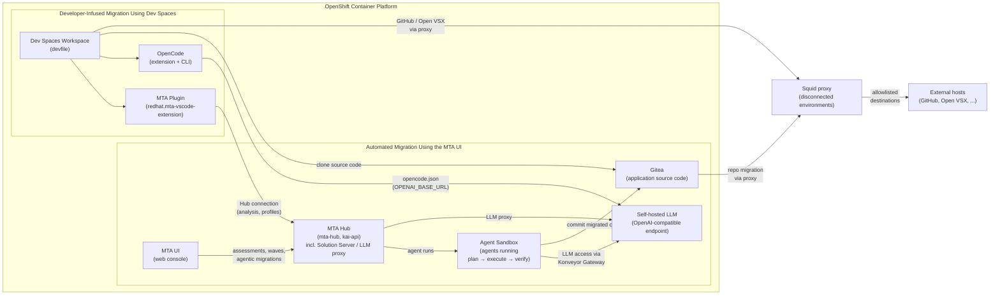

# Migration Toolkit for Applications Use-Cases

The [**Migration Toolkit for Applications**](https://developers.redhat.com/products/mta) (MTA) helps you to migrate your existing application. Its main use cases are:

1. **Legacy app assessment** — Static analysis of application source code and archives to inventory applications, identify technologies used, and estimate effort/cost of migration (sizing for modernization programs).
2. **Migration to newer platforms** — Moving Java applications from older application servers (WebLogic, WebSphere, JBoss EAP 4/5/6/7, Tomcat) to newer versions of JBoss EAP or other runtimes.
3. **Lift-and-shift to cloud / containers** — Migrating monoliths to OpenShift/Kubernetes, containerizing applications, and moving from on-premise to hybrid cloud.
4. **Java version upgrades** — Upgrading JDK versions and migrating from proprietary APIs to open standards (e.g., Java EE → Jakarta EE, Oracle JDK → OpenJDK).
5. **Monolith decomposition** — Identifying candidates for refactoring into microservices, highlighting hard-coded dependencies and configuration issues.
6. **Governance at scale** — Central reporting across a large application portfolio (wave planning), enabling organizations to plan, prioritize, and track modernization programs.

In practice MTA works in two modes: the **web console** (portfolio analysis, project/wave management) and the **CLI** (developer-driven, single-app analysis), producing detailed reports of issues, migration rules triggered, and suggested code changes. There's also IDE integration (VS Code) for inline remediation hints.

This PoC is divided into two parts:

1. **[Automated Migration Using the MTA UI](#automated-migration-using-the-mta-ui)** — portfolio analysis, agentic migrations, and wave management through the MTA web console.
2. **[Developer-Infused Migration Using OpenShift Dev Spaces and the MTA Plugin](#developer-infused-migration-using-openshift-dev-spaces-and-the-mta-plugin)** — developers drive the analysis and remediation of their applications from within their IDE.

## Architecture Overview

The following diagram highlights how the components of this PoC relate to each other:



Both parts share the same **self-hosted LLM**: the MTA plugin reaches it through the Hub's LLM proxy, the agentic workflows through the Konveyor Gateway, and the OpenCode agent directly via the `OPENAI_BASE_URL` configured in `opencode.json`. The **Squid proxy** is optional and only deployed in disconnected environments, providing allowlisted outbound egress (GitHub, Open VSX, ...) for the workspaces and Gitea; in a connected environment these components reach the external hosts directly.

## Prerequisites

Below you can find the requirements for getting started with this PoC:

- **OpenShift CLI (oc)**: Ensure the `oc` command-line tool is installed and logged in to the target OpenShift cluster with `cluster-admin` privileges.
- **Helm CLI**: Ensure the `helm` CLI is installed (v3.x) for deploying the Gitea chart via Helm.
- **OpenShift Cluster Access**: An operational Red Hat OpenShift Container Platform cluster (v4.22 recommended) with sufficient resources for running OpenShift Dev Spaces and MTA workloads.
- **Subscription Requirements**: Ensure an active Red Hat Advanced Developer Suite (RHADS) subscription is available to access Developer Lightspeed services.
- **Storage & Registry Access**: A configured default StorageClass supporting dynamic persistent volume provisioning and access to the Red Hat Ecosystem Catalog/OperatorHub.
- **OpenAI-Compatible LLM Access**: Access to an OpenAI-compatible Large Language Model (LLM) endpoint and API key, required for Red Hat Developer Lightspeed and agentic migration features.
- **Define environment variables**: To ease the deployment of the Kubernetes resources later define these environment variables

```bash
export OPENAI_HOST=<Your LLM endpoint host>
export OPENAI_BASE_URL=https://${OPENAI_HOST}/v1
export OPENAI_API_KEY="<Your API Key>"
export OPENAI_MODEL_NAME="<Your Model name>"
export STORAGECLASS_RWX=ocs-external-storagecluster-cephfs
export OPENSHIFT_APPS_DOMAIN=$(oc get ingresses.config.openshift.io cluster -o jsonpath='{.spec.domain}')
```

To verify the LLM endpoint is reachable and the model responds, send a test request via `curl`:

```bash
curl -s ${OPENAI_BASE_URL}/chat/completions \
  -H "Content-Type: application/json" \
  -H "Authorization: Bearer ${OPENAI_API_KEY}" \
  -d '{
    "model": "'"${OPENAI_MODEL_NAME}"'",
    "messages": [{"role": "user", "content": "Hello"}],
    "max_tokens": 16
  }' | jq .
```

The response should contain the model's completion, e.g.:

```json
{
  "id": "chatcmpl-...",
  "model": "<Your Model name>",
  "choices": [
    {
      "index": 0,
      "message": {
        "role": "assistant",
        "content": "Hello! How can I help you today?"
      },
      "finish_reason": "stop"
    }
  ],
  ...
}
```

## Squid proxy deployment (disconnected environments)

In a disconnected environment, the workloads in this PoC still need controlled outbound access to external hosts: Gitea migrates the original repositories from GitHub, Dev Spaces workspaces reach GitHub and the Open VSX registry, and the MTA Hub reaches the analyzer package repositories. Deploy a Squid proxy to the cluster to provide this egress. It acts as a forward proxy — the workloads point at it via the standard `HTTP_PROXY`/`HTTPS_PROXY` environment variables, which are set from the `MTA_`-prefixed shell variables described in [Proxy configuration](#proxy-configuration) — and only allows traffic to allowlisted destinations.

Deploy the proxy with the manifest in `squid/squid.yaml`. It creates the `squid` namespace, a `squid-config` ConfigMap with the `squid.conf` configuration, a Deployment running the Red Hat `rhel9/squid` image, and a Service exposing it on port 3128. The `squid.conf` is mounted as a single file into `/etc/squid` (via `subPath`) to preserve the image's stock `mime.conf`, which Squid requires to start:

```bash
oc apply -f squid/squid.yaml
oc wait --for=condition=Available deployment squid -n squid --timeout=300s
```

The Squid configuration only permits `CONNECT` (HTTPS) requests to port 443, restricts proxy clients to the cluster networks (adjust the `cluster_networks` ACL to the Pod CIDR of the cluster), and only allows the destinations in the `allowed_domains` ACL. The pid file and coredump directory are configured as `/tmp` because OpenShift runs containers with a random UID (restricted SCC). To allow further destinations, edit the `squid.conf` in the `squid-config` ConfigMap and restart the deployment — the config file is mounted with `subPath`, so changes are not picked up automatically:

```bash
oc edit configmap squid-config -n squid
oc rollout restart deployment squid -n squid
```

Verify that the proxy is running and forwards traffic to an allowed destination:

```bash
oc exec -n squid deploy/squid -- curl -s -o /dev/null -w '%{http_code}\n' -x http://localhost:3128 -I https://github.com
```

The command should return `200`. Note that requests from inside the Squid pod match the unrestricted `http_access allow localhost` ACL, so this check does not exercise the `cluster_networks` and `allowed_domains` restrictions — to verify the proxy the way a workload sees it, run the same check from a Dev Spaces workspace terminal against `http://squid.squid.svc:3128` instead.

Finally, point the proxy at the in-cluster service by exporting the `MTA_`-prefixed proxy environment variables (used by the [Gitea](#gitea-installation), [MTA](#proxy-settings-for-disconnected-environments) and Dev Spaces proxy sections). The `MTA_` prefix avoids conflicts with the proxy settings of the shell the subsequent commands are run from:

```bash
export MTA_HTTP_PROXY=http://squid.squid.svc:3128
export MTA_HTTPS_PROXY=http://squid.squid.svc:3128
export MTA_NO_PROXY=localhost,127.0.0.1,.svc,.cluster.local,.${OPENSHIFT_APPS_DOMAIN}
```

> ⚠️ NOTE
>
> - The `MTA_NO_PROXY` list contains the cluster-internal hosts, so traffic between the workloads (e.g. Gitea, MTA Hub, Dev Spaces) bypasses the proxy.
> - The Squid pod itself needs outbound connectivity through the corporate firewall to the allowed destinations. Ensure the firewall allows the egress route of the Squid pod (e.g. via the node IP or a dedicated egress IP). If the cluster nodes have no outbound connectivity at all, deploy the proxy outside the cluster instead and point the environment variables at it.
> - In a disconnected environment the `rhel9/squid` image must be mirrored into the internal image registry; update `squid/squid.yaml` accordingly before applying it. The image is only available from `registry.redhat.io` and requires a Red Hat pull secret — in a connected environment, attach the pull secret to the default service account of the `squid` namespace before applying the manifest.
> - OpenShift runs containers with a random UID (restricted SCC). The `squid.conf` therefore configures the pid file (`pid_filename /tmp/squid.pid`) and the coredump directory (`coredump_dir /tmp`) as writable locations.

## Gitea installation

To prevent unwanted changes and/or commits to existing source code, the original repos will be cloned into a Gitea instance that will be running on OpenShift.

- **Gitea Helmchart**: To install the Gitea Helmchart run
    ```bash
    oc apply -f gitea/gitea-namespace.yaml
    helm repo add gitea-charts https://dl.gitea.com/charts/
    helm repo update
    cat gitea/values.yaml | envsubst | helm install -n gitea -f - gitea gitea-charts/gitea
    oc wait --for=jsonpath='{.status.readyReplicas}'=1 statefulset gitea-valkey-primary -n gitea --timeout=600s
    oc wait --for=jsonpath='{.status.readyReplicas}'=1 statefulset gitea-postgresql -n gitea --timeout=600s
    cat gitea/create-db.sh | oc exec statefulset/gitea-postgresql -n gitea -i -t -- bash -il
    oc wait --for=jsonpath='{.status.readyReplicas}'=1 deployment gitea -n gitea --timeout=600s
    ```
    To verify that the deployment has been successful open the URL resulting from the following command:
    ```bash
    echo "Gitea URL: https://$(oc get route gitea -n gitea -o jsonpath='{.spec.host}')"
    ``` 
    You should see the following page:
    

    To login click on the `Sign in` button and use the credentials `gitea-admin/giteaftw!`.    
- **Verify Open API endpoint**: To verify if the Gitea Open API endpoint is working use
    ```bash
    curl -s -o /dev/null -w "%{http_code}\n" https://git.${OPENSHIFT_APPS_DOMAIN}/api/swagger
    ```
    The expected output should be `200`.
- **Access Token**:For any actions later we will need an access token

    ```bash
    export GITEA_ADMIN_TOKEN=$(curl -s -H "Content-Type: application/json" -d '{"name":"admin_token","scopes":["all"]}' -u 'gitea-admin:giteaftw!' "https://git.${OPENSHIFT_APPS_DOMAIN}/api/v1/users/gitea-admin/tokens" | jq -r '.sha1')
    ```
    To verify that the token works run
    ```bash
    curl -s -o /dev/null -w "%{http_code}\n" \
    "https://git.${OPENSHIFT_APPS_DOMAIN}/api/v1/user" \
    -H "Authorization: token ${GITEA_ADMIN_TOKEN}"
    ```
    This should return `200`.

    In case you need to delete this token use the following command
    ```bash
    curl --request DELETE https://git.${OPENSHIFT_APPS_DOMAIN}/api/v1/users/gitea-admin/tokens/admin_token   --header "Authorization: Basic $(echo -n 'gitea-admin:giteaftw!' | base64)"
    ```

- **Cloning Repositories**: Now we will clone the [JBoss EAP Quickstarts](https://github.com/jboss-developer/jboss-eap-quickstarts) repository into Gitea using the REST-API. This will also require to create an organization `jboss`

    ```bash
    curl -s -X POST "https://git.${OPENSHIFT_APPS_DOMAIN}/api/v1/orgs" \
    -H "Authorization: token ${GITEA_ADMIN_TOKEN}" \
    -H "Content-Type: application/json" \
    -d '{"username": "jboss", "visibility": "public"}'

    curl -X POST "https://git.${OPENSHIFT_APPS_DOMAIN}/api/v1/repos/migrate" \
    -H "Authorization: token ${GITEA_ADMIN_TOKEN}" \
    -H "Content-Type: application/json" \
    -d '{
        "clone_addr": "https://github.com/jboss-developer/jboss-eap-quickstarts",
        "repo_name": "jboss-quickstarts",
        "repo_owner": "jboss"
    }'

    curl -s -X POST "https://git.${OPENSHIFT_APPS_DOMAIN}/api/v1/admin/users" \
    -H "Authorization: token ${GITEA_ADMIN_TOKEN}" \
    -H "Content-Type: application/json" \
    -d '{
        "username": "jboss-dev",
        "email": "jboss-dev@example.com",
        "password": "jboss-dev",
        "must_change_password": false
    }'

    export GITEA_OWNERS_TEAM_ID=$(curl -s "https://git.${OPENSHIFT_APPS_DOMAIN}/api/v1/orgs/jboss/teams"   -H "Authorization: token ${GITEA_ADMIN_TOKEN}" | jq '.[].id')

    curl -s -X PUT "https://git.${OPENSHIFT_APPS_DOMAIN}/api/v1/teams/${GITEA_OWNERS_TEAM_ID}/members/jboss-dev"   -H "Authorization: token ${GITEA_ADMIN_TOKEN}"
    ```
    To verify if the cloning was successful run
    ```bash
    git clone https://git.${OPENSHIFT_APPS_DOMAIN}/jboss/jboss-quickstarts ~/jboss-quickstarts
    ```
- **Proxy settings (disconnected environments)**: Gitea needs outbound access to GitHub to migrate the original repositories. In a disconnected environment, route this traffic through a proxy. Define the `MTA_`-prefixed proxy environment variables (see [Proxy configuration](#proxy-configuration)) and install the chart with the additional values file `gitea/values-proxy.yaml`. Both values files are substituted with `envsubst` during the installation, so the `MTA_`-prefixed shell variables are resolved automatically, while the Gitea container receives the standard `HTTP_PROXY`/`HTTPS_PROXY`/`NO_PROXY` environment variables:

    ```bash
    oc apply -f gitea/gitea-namespace.yaml
    helm repo add gitea-charts https://dl.gitea.com/charts/
    helm repo update
    helm install -n gitea \
      -f <(envsubst < gitea/values.yaml) \
      -f <(envsubst < gitea/values-proxy.yaml) \
      gitea gitea-charts/gitea
    oc wait --for=jsonpath='{.status.readyReplicas}'=1 statefulset gitea-valkey-primary -n gitea --timeout=600s
    oc wait --for=jsonpath='{.status.readyReplicas}'=1 statefulset gitea-postgresql -n gitea --timeout=600s
    cat gitea/create-db.sh | oc exec statefulset/gitea-postgresql -n gitea -i -t -- bash -il
    oc wait --for=jsonpath='{.status.readyReplicas}'=1 deployment gitea -n gitea --timeout=600s
    ```

    The proxy environment variables are set on all containers of the Gitea deployment via the chart's `deployment.env` property. To verify that they have been propagated:

    ```bash
    oc get pod -n gitea -o yaml | grep -iE 'proxy'
    ```

- **SSH Keys**: If SSH keys should be used for authentication against the Git repository in addition to basic auth, first generate a keypair (skip this step if you already have one):

  ```bash
  ssh-keygen -t ed25519 -f ~/.ssh/mta-gitea -N "" -C "mta-agents"
  ```

  Then add the public key to the Git server (for Gitea this can also be done via the REST API). The key is passed to `curl` via `jq` to ensure it is properly expanded and JSON-escaped:

  ```bash
  curl -s -X POST "https://git.${OPENSHIFT_APPS_DOMAIN}/api/v1/user/keys" \
    -H "Authorization: token ${GITEA_ADMIN_TOKEN}" \
    -H "Content-Type: application/json" \
    -d "{
      \"title\": \"mta-agents\",
      \"key\": \"$(cat ~/.ssh/mta-gitea.pub)\"
    }"
  ```

  To verify that the key works, clone a repository over SSH. Three details of the deployed Gitea matter here:

  - **SSH is exposed through a TLS-passthrough Route**: Routes carry HTTP(S) traffic only, so the plain-SSH server (the chart's `gitea-ssh` Service, container port 2222) is wrapped in TLS by a socat proxy and published through a passthrough Route on `git-ssh.${OPENSHIFT_APPS_DOMAIN}`. The Route does not terminate TLS — the socat proxy presents the certificate, so a cert for the Route host is generated explicitly (the service CA operator can only issue for `<service>.<namespace>.svc` names, not for a Route host):

      ```bash
      openssl req -x509 -newkey rsa:4096 -sha256 -days 365 -nodes \
        -keyout gitea-ssh-route-key.pem -out gitea-ssh-route-cert.pem \
        -subj "/CN=git-ssh.${OPENSHIFT_APPS_DOMAIN}" \
        -addext "subjectAltName=DNS:git-ssh.${OPENSHIFT_APPS_DOMAIN}"

      oc create secret tls gitea-ssh-route-cert -n gitea \
        --cert=gitea-ssh-route-cert.pem --key=gitea-ssh-route-key.pem
      ```

      Deploy the tunnel with:

      ```bash
      cat gitea/gitea-ssh-route.yaml | envsubst | oc apply -f -
      oc wait --for=jsonpath='{.status.readyReplicas}'=1 deployment gitea-ssh-tunnel -n gitea --timeout=300s
      ```

      The self-signed cert has a fixed expiry (365 days) and does not auto-renew — re-run the `openssl` and `oc create secret` commands (and restart the tunnel deployment) to rotate it. To verify the presented certificate, check that its subject matches the Route host:

      ```bash
      echo "" | openssl s_client -connect git-ssh.${OPENSHIFT_APPS_DOMAIN}:443 -servername git-ssh.${OPENSHIFT_APPS_DOMAIN} 2>/dev/null | openssl x509 -noout -subject
      ```

      In-cluster consumers (e.g. the agentic Sandboxes) bypass the tunnel and reach the SSH server directly at `gitea-ssh.gitea.svc:22`.

  - **The SSH username is `git`**: Gitea's built-in SSH server requires one fixed username for all git operations over SSH — the `[server] BUILTIN_SSH_SERVER_USER` setting, which defaults to the OS user running Gitea. On OpenShift that is the random container UID (e.g. `1000810000`), so `gitea/values.yaml` pins it to `git` via the chart's config (`gitea.config.server.BUILTIN_SSH_SERVER_USER: git`, plus `SSH_USER: git` for the clone URLs the UI displays). Any other username is rejected with `Permission denied (publickey)`, and the server log records `Invalid SSH username <name> - must use ...`. Note the username is still only a gate — the key is matched against the Gitea account it is registered with (`gitea-admin` here), not against the username.

  Clone the previously migrated repository over SSH. Because the Route is TLS-passthrough, ssh unwraps the TLS layer with an `openssl` ProxyCommand — `%h` expands to the clone URL's host, which is the Route host. The `GIT_SSH_COMMAND` also pins the key — `IdentitiesOnly=yes` stops ssh from offering the agent's other keys first — and skips the host-key prompt and TLS verification, since the self-signed cert is not in a trust store (verify it separately with the `openssl s_client` check above if needed):

  ```bash
  GIT_SSH_COMMAND="ssh -i ~/.ssh/mta-gitea -o IdentitiesOnly=yes -o StrictHostKeyChecking=no -o UserKnownHostsFile=/dev/null -o ProxyCommand='openssl s_client -quiet -connect %h:443 -servername %h'" \
  git clone git@git-ssh.${OPENSHIFT_APPS_DOMAIN}:jboss/jboss-quickstarts ~/jboss-quickstarts-ssh
  ```

  On success git prints `Cloning into ...` and the working tree appears under the target directory; the server's greeting (`Hi there, gitea-admin! You've successfully authenticated with the key named mta-agents ...`) confirms the key matched.

## Automated Migration Using the MTA UI

This part covers the automated, portfolio-wide migration using the MTA web console, including the agentic migration workflows that run on the cluster.

### Agent Sandbox Installation
For Agentic Migrations via MTA we need to have the **Agent Sandbox Operator** installed as the agents will be running in sandboxes:

```bash
oc apply -f agent-sandbox/agent-sandbox-operator.yaml
```
The deployment of the Agent Sandbox operator can be verified like this:
    
```bash
oc wait --for=create deployment agent-sandbox-controller -n agent-sandbox-system --timeout=600s
oc wait --for=jsonpath='{.status.readyReplicas}'=1 deployment agent-sandbox-controller -n agent-sandbox-system --timeout=600s
```
The expected output for each command is **`condition met`**.

### Migration Toolkit for Applications (MTA) 8.3

#### Installation
MTA 8.3 provides automated analysis, assessment, and refactoring tooling for application modernization:
- **Prerequisites**: OpenShift Container Platform installed with cluster-admin privileges, along with persistent storage requirements including 1 RWO PV (10Gi) for the Hub database, 2 RWX PVs (100Gi each) for Maven cache and Hub bucket storage (if `rwx_supported` is enabled), and 1 RWO PV (5Gi) for the Developer Lightspeed database. You will also need access to a Large Language Model.
- **Deploy the Migration Toolkit for Applications Operator**:  Via the CLI by creating the target namespace, OperatorGroup, and Subscription resources:

    ```bash
    oc apply -f mta-ui/mta-operator.yaml
    ```
    The steps to verify if the deployment of the operator has finished successfully are as follows
    ```bash
    oc wait --for=create csv mta-operator.v8.3.2 -n openshift-mta --timeout=600s
    oc wait --for=jsonpath='{.status.phase}'=Succeeded csv mta-operator.v8.3.2 -n openshift-mta --timeout=600s
    oc wait --for=create deployment mta-operator -n openshift-mta --timeout=600s
    oc wait --for=jsonpath='{.status.readyReplicas}'=1 deployment mta-operator -n openshift-mta --timeout=600s
    ```
    Each command should return a **`condition met`**.
- **Create the Model Secret**: Create a Kubernetes Secret containing the API key and Base URL required for the self-hosted model LLM provider. This is needed for the Solution Server that is a core component deployed into the cluster that acts as an MCP server, maintaining persistent memory of refactoring resolutions and interfacing with Large Language Models (LLMs) via Retrieval-Augmented Generation (RAG):
    ```bash
    cat mta-ui/mta-ls-llm-provider-secret.yaml | envsubst | oc apply -f -
    ```
- **Configure the Tackle Instance**: Create a Tackle instance specifying the amount of storage needed, enabling Developer Lightspeed and configuring the Large Language Model (LLM):

    ```bash
    cat mta-ui/tackle.yaml | envsubst | oc apply -f -
    ```
    Wait until the installation has finished successfully:
    ```bash
    oc wait --for=create deployment mta-ui -n openshift-mta --timeout=600s
    oc wait --for=create deployment mta-hub -n openshift-mta --timeout=600s
    oc wait --for=create deployment kai-db -n openshift-mta --timeout=600s
    oc wait --for=create deployment kai-api -n openshift-mta --timeout=600s
    oc wait --for=create deployment agentic-controller -n openshift-mta --timeout=600s
    oc wait --for=jsonpath='{.status.readyReplicas}'=1 deployment mta-ui -n openshift-mta --timeout=600s
    oc wait --for=create deployment mta-hub -n openshift-mta --timeout=600s
    oc wait --for=jsonpath='{.status.readyReplicas}'=1 deployment mta-hub -n openshift-mta --timeout=600s
    oc wait --for=jsonpath='{.status.readyReplicas}'=1 deployment kai-db -n openshift-mta --timeout=600s
    oc wait --for=jsonpath='{.status.readyReplicas}'=1 deployment kai-api -n openshift-mta --timeout=600s
    oc wait --for=jsonpath='{.status.readyReplicas}'=1 deployment agentic-controller -n openshift-mta --timeout=600s
    ```
    All these commands should return `condition met`.
- **Workaround for Storage issue**: In some cases there may be an issue with the cache PVC (`/cache/m2 can't be created`), this is how to fix it:

    ```bash
    oc apply -f mta-ui/cache-pvc-inspector.yaml
    oc wait --for=create deployment cache-pvc-inspector -n openshift-mta --timeout=600s
    oc wait --for=jsonpath='{.status.readyReplicas}'=1 deployment cache-pvc-inspector -n openshift-mta --timeout=600s
    echo "mkdir /cache/m2" | oc exec deployment/cache-pvc-inspector -n openshift-mta -i -t -- bash -il
    ```
    To verify that the directory has been created run
    ```
    oc exec deployment/cache-pvc-inspector -n openshift-mta -- \
  bash -c "if [ -d /cache/m2 ]; then echo '/cache/m2 exists'; else echo '/cache/m2 does not exist'; fi"
    ```
    The expected output should be `/cache/m2 exists`.

    We can now delete the PVC inspector deployment
    ```bash
    oc delete -f mta-ui/cache-pvc-inspector.yaml
    ```
- **Create a Konveyor Gateway**: The `Konveyor Gateway` abstracts the access to the LLM.
    ```bash
    cat mta-ui/llm-gateway.yaml | envsubst | oc apply -f -
    ```
    To verify the gateway instantiation execute
    ```bash
    oc wait --for create gateways.konveyor.io openai -n openshift-mta --timeout=600s
    oc wait --for=jsonpath='{.status.connectionVerified}'="true" gateways.konveyor.io openai -n openshift-mta --timeout=600s
    ```
    All these commands should return `condition met`.


    If you want to change the model you have two options:
    - Change the current `Konveyor Gateway` resource
    - Create another `Konveyor Gateway` resource in addition

    If you later you want to run an `Agentic Migration` you will be prompted which Konveyor Gateway to use, and the run dialog also prompts for the target branch. The target branch is prefilled with the UI default `konveyor/migration-<timestamp>` (hardcoded in the MTA UI as `TARGET_BRANCH_PREFIX`), but it can be edited per run — any valid git refname except the application's source branch (the harness refuses to push onto the source branch) is accepted. The results, including the committed handoff files, are pushed to this target branch.
- **Accessing the MTA UI**: The MTA UI can be accessed like this:

    ```bash
    echo "MTA UI: https://$(oc get route mta -n openshift-mta -o jsonpath='{.spec.host}')"
    ``` 
    You should be presented with a screen like this:

        

    Login with `admin/admin`.

#### Proxy settings for disconnected environments

The `Tackle` custom resource and the `Konveyor Gateway` custom resource do not provide proxy settings. However, the MTA Operator automatically propagates the standard `HTTP_PROXY`/`HTTPS_PROXY`/`NO_PROXY` environment variables from its own pod environment to the `mta-hub` container on reconciliation. In a disconnected environment:

- **LLM access**: No proxy is required for LLM access if the LLM is hosted internally. Point the LLM provider Secret (`mta-ls-llm-provider-secret`) and the `Konveyor Gateway` endpoint at the internal LLM.
- **Other outbound traffic**: Define the `MTA_`-prefixed proxy environment variables (see [Proxy configuration](#proxy-configuration)) and set them on the MTA Operator deployment using `oc set env`, with their values resolved from the `MTA_`-prefixed shell variables:

    ```bash
    oc set env deployment/mta-operator -n openshift-mta \
      HTTP_PROXY=${MTA_HTTP_PROXY} \
      HTTPS_PROXY=${MTA_HTTPS_PROXY} \
      NO_PROXY=${MTA_NO_PROXY}
    oc rollout restart deployment mta-operator -n openshift-mta
    oc wait --for=jsonpath='{.status.readyReplicas}'=1 deployment mta-operator -n openshift-mta --timeout=600s
    ```

    The operator renders the variables into the `mta-hub` deployment on its next reconciliation. To verify that they have been propagated:

    ```bash
    oc get deployment mta-hub -n openshift-mta -o jsonpath='{.spec.template.spec.containers[0].env}' | jq '.[] | select(.name | test("PROXY"; "i"))'
    ```

    > ⚠️ NOTE
    >
    > Only the `mta-hub` container receives the proxy environment variables — the `kai-api` and `agentic-controller` deployments do not render proxy settings from the `Tackle` CR or the operator environment. The `NO_PROXY` list must include the cluster-internal hosts (e.g. the wildcard domain of the internal routes such as Gitea and Keycloak) so that internal traffic bypasses the proxy.

#### Setting the Hub proxy via the Tackle Hub API

The environment-variable propagation above affects the `mta-hub` container process. Independently of it, the Hub stores proxy settings **centrally** — the same data as the UI's *Settings → Proxy* table — exposed via the [Tackle2-Hub API](https://github.com/konveyor/tackle2-hub/blob/main/docs/swagger.yaml) at `/hub/proxies` (an internal, unsupported surface — see the warning below). Two default entries are seeded on installation, `http` (id `1`) and `https` (id `2`), both `enabled: false` with an empty host and port. Inspect them with:

```bash
curl -s "${MTA_URL}/hub/proxies" -u admin:admin | jq '.[] | {id, kind, enabled, host, port, excluded}'
```

These settings configure the Hub's **own git/svn operations**: when the Hub fetches or pushes a repository (e.g. migrating the original repositories from GitHub), it derives the `http.proxy` of the generated `~/.gitconfig` from the `enabled: true` entry matching the clone URL's scheme, and resolves the entry's `identity` reference to add `user:password@` proxy authentication. Clone URLs with the `ssh` scheme bypass the proxy entirely. The entry fields are:

| Field      | Description                                                                                                        |
|------------|--------------------------------------------------------------------------------------------------------------------|
| `enabled`  | Only `true` entries are used by the Hub.                                                                           |
| `kind`     | Scheme the proxy serves: `http` or `https`.                                                                         |
| `host`     | Proxy host (built without a scheme — the Hub always produces `http://<host>:<port>`).                              |
| `port`     | Proxy port; `0` omits it.                                                                                           |
| `excluded` | Hosts that bypass the proxy. **Exact string match** against the clone URL's host — no wildcards or suffix matching. |
| `identity` | Reference to an Identity with `user`/`password` for proxy authentication, or `null`.                                |

> ⚠️ NOTE
>
> The `excluded` semantics differ from `NO_PROXY`: the Hub compares each entry **exactly** against the clone URL's host, so suffix-style entries such as `.svc` or `.apps.<domain>` have no effect on Hub git operations. Add the exact internal route hosts instead — e.g. `git.${OPENSHIFT_APPS_DOMAIN}` (the Gitea HTTPS route) — so the Hub reaches them directly rather than through the proxy, which would otherwise only allowlist external destinations.

Set both entries from the `MTA_`-prefixed proxy environment variables, deriving `host` and `port` from `MTA_HTTP_PROXY` the same way as the [Maven settings](#configure-maven-settings) and appending the exact internal hosts to the `excluded` list:

```bash
PROXY_HOST=$(echo "${MTA_HTTP_PROXY#*://}" | cut -d: -f1)
PROXY_PORT=$(echo "${MTA_HTTP_PROXY#*://}" | cut -s -d: -f2)
PROXY_PORT=${PROXY_PORT:-80}
PROXY_EXCLUDED=${MTA_NO_PROXY},git.${OPENSHIFT_APPS_DOMAIN},git-ssh.${OPENSHIFT_APPS_DOMAIN}

for kind in http https; do
  id=$([ $kind = http ] && echo 1 || echo 2)
  curl -s -X PUT "${MTA_URL}/hub/proxies/${id}" \
    -u admin:admin \
    -H "Content-Type: application/json" \
    -d "$(jq -n \
      --arg kind "$kind" \
      --arg host "$PROXY_HOST" \
      --argjson port "$PROXY_PORT" \
      --argjson excluded "$(printf '%s' "$PROXY_EXCLUDED" | jq -R 'split(",")')" \
      '{enabled: true, kind: $kind, host: $host, port: $port, excluded: $excluded, identity: null}')"
done
```

On success each `PUT` returns `204 No Content`. Verify with the `GET` above. To disable the proxy for the Hub again, `PUT` the entries with `"enabled": false`. Like the identity resources, the `PUT` is a full-object update — fetch the entry first and modify it rather than writing blind if an `identity` reference is already set.

> ⚠️ NOTE
>
> This configures only the Hub's own git/svn operations. The analyzer task pods (`kantra`) and the agentic Sandboxes do not consume these settings — their outbound traffic still needs the environment-variable propagation above (and the Maven proxy identity for builds, see [Configure Maven settings](#configure-maven-settings)).

#### Automation via REST API

Using the Konveyor [Tackle2-Hub API](https://github.com/konveyor/tackle2-hub/blob/main/docs/swagger.yaml) you can automate the configuration of the MTA.

> ⚠️ WARNING
>
> The Tackle2-Hub API is an internal implementation detail that is not a supported product feature.

For this we first need to get the endpoint:
```bash
export MTA_URL="https://$(oc get route mta -n openshift-mta -o jsonpath='{.spec.host}')"
```

##### Creating Stakeholders, Stakeholder Groups and Business Service
Create a stakeholder and assign him to the stakeholder group named **JBoss Quickstarts** and a business service named **JBoss Onboarding**.
```bash
MTA_USER_ID=$(curl -s -X POST "${MTA_URL}/hub/stakeholders"   -u admin:admin   -H "Content-Type: application/json"   -d '{
"name": "John Doe",
"email": "john@example.com",
"jobFunction": {"id": 1, "name": "IT"}
}' | jq '.id')

curl -s -X POST "${MTA_URL}/hub/stakeholdergroups" \
-u admin:admin \
-H "Content-Type: application/json" \
-d "{
    \"name\": \"JBoss EAP Quickstarts\",
    \"description\": \"Stakeholders owning migrated JBoss EAP Quickstarts applications\",
    \"stakeholders\": [
    {\"id\": ${MTA_USER_ID}, \"name\": \"John Doe\"}
    ]
}"

curl -s -X POST "${MTA_URL}/hub/businessservices" \
-u admin:admin \
-H "Content-Type: application/json" \
-d "{
    \"name\": \"JBoss Onboarding\",
    \"description\": \"Onboarding Developers onto JBoss\",
    \"owner\": {\"id\": ${MTA_USER_ID}, \"name\": \"John Doe\"}
}"
```

##### Configure Maven settings

if you need a custom Maven `settings.xml`, f.e. for connecting to [JFrog Artifactory](https://jfrog.com/artifactory/) or [Sonatype Nexus](https://www.sonatype.com/products/sonatype-nexus-repository) you can use the following command as an example, which configures the `Red Hat GA` repository for dependencies and plugins. In a disconnected environment, the `mta-ui/maven-settings.xml` also contains a `<proxies>` block, which is populated from the `MTA_`-prefixed proxy environment variables (see [Proxy configuration](#proxy-configuration)). Maven requires the protocol, host, port, and non-proxy hosts separately, so they are derived from `MTA_HTTP_PROXY` and `MTA_NO_PROXY` first:

```bash
export MAVEN_PROXY_PROTOCOL=${MTA_HTTP_PROXY%%://*}
export MAVEN_PROXY_HOST=$(echo "${MTA_HTTP_PROXY#*://}" | cut -d: -f1)
export MAVEN_PROXY_PORT=$(echo "${MTA_HTTP_PROXY#*://}" | cut -s -d: -f2)
export MAVEN_PROXY_PORT=${MAVEN_PROXY_PORT:-80}
export MAVEN_PROXY_NONPROXYHOSTS=${MTA_NO_PROXY//,/\|}
export MAVEN_SETTINGS=$(envsubst < mta-ui/maven-settings.xml | sed 's/\"/\\\"/g' | tr '\n' ' ')
curl -s -X POST "${MTA_URL}/hub/identities" \
  -u admin:admin \
  -H "Content-Type: application/json" \
  -d "{
    \"name\": \"maven-redhat-ga-settings\",
    \"kind\": \"maven\",
    \"description\": \"Maven settings for Red Hat GA repository\",
    \"default\": true,
    \"settings\": \"${MAVEN_SETTINGS}\"
  }"

export MAVEN_IDENTITY_ID=$(curl -s "${MTA_URL}/hub/identities" -u admin:admin \
  | jq -r '.[] | select(.name=="maven-redhat-ga-settings") | .id')
```

The `nonProxyHosts` list is derived by replacing the commas of `MTA_NO_PROXY` with the `|` separator Maven expects, and contains the cluster-internal hosts so Maven does not route internal traffic through the proxy. If no proxy is required, remove the `<proxies>` block from `mta-ui/maven-settings.xml` before creating the identity. As with the Git credentials, the identity POST returns `409 Conflict` if the identity already exists — the ID is looked up by name instead of captured from the POST response.

Note that a `maven`-kind identity is only consumed by analyses. The analyzer resolves it the same two-step way as the Git credentials: its Resource Injector first tries an identity **linked to the application with the role `maven`** (the direct search filters on the role exactly), falling back to the global **default** (`kind: maven` and `default: true`). Because the identity is created as the default, it resolves for every application without linking — the same behavior as the `git-credentials` identity. To override the Maven settings for a specific application (e.g. per-app repositories), link a different `maven`-kind identity to it with the role `maven` using the same full-object `PUT` pattern as the Git credentials — the direct link takes precedence over the default:

```bash
curl -s -X PUT "${MTA_URL}/hub/applications/${APP_ID}" \
  -u admin:admin \
  -H "Content-Type: application/json" \
  -d "$(curl -s "${MTA_URL}/hub/applications/${APP_ID}" -u admin:admin \
    | jq --argjson id "${MAVEN_IDENTITY_ID}" \
        '.identities = (((.identities // []) | map(select(.id != $id))) + [{id: $id, role: "maven"}])')"
```

An application can carry both links side by side — the `git-credentials` identity with the role `source` (for cloning/pushing) and the Maven settings identity with the role `maven` (for builds). On resolution the injector extracts the identity's `settings` field, writes it to `/shared/creds/maven/settings.xml` in the analysis task, and passes the path to the Java provider as `mavenSettingsFile`. **Agentic Workflow runs** do not resolve Maven settings from the Hub, and the deployed MTA Hub's REST binding rejects the `spec.fileMounts` field (a newer Hub version accepts it), so agentic runs carry custom Maven settings via the `MAVEN_SETTINGS_XML` environment variable instead — see [Start an Agent Workflow Run](#start-an-agent-workflow-run).

##### Bulk Uploading Applications

```bash
cat mta-ui/template_application_import.csv | envsubst > mta-ui/application_import.csv
curl -s -X POST "${MTA_URL}/hub/importsummaries/upload" \
  -u admin:admin \
  -F "file=@mta-ui/application_import.csv"
```

On success it returns `201 Created` with an `ImportSummary` JSON object.

The template uses **HTTPS repository URLs** (`https://git.${OPENSHIFT_APPS_DOMAIN}/...`), so the MTA analyzer clones the applications over HTTPS with basic auth. The basic-auth `git-credentials` identity created in the [Create default Git credentials](#create-default-git-credentials) section is the global default, so it resolves for every imported application. The `envsubst` here is also the place where a stale `OPENSHIFT_APPS_DOMAIN` shell variable would bake a wrong hostname into the application records.

> ⚠️ WARNING
>
> The repository URLs must use the **HTTPS scheme**: the agentic harness takes the application's URL verbatim and clones/pushes in-process with the Go git library, whose only auth method is HTTP basic auth — an `ssh://git@git-ssh.${OPENSHIFT_APPS_DOMAIN}:443/...` URL (the SSH route from the [SSH clone test](#ssh-keys)) would fail the agentic run at the clone step, and the TLS-passthrough SSH route could not be traversed by the harness anyway. SSH URLs serve the workstation-side SSH flow only. Likewise, a `source`-kind SSH-key identity (e.g. `git-ssh-credentials`) linked to an application or set as default does not affect the harness — it authenticates the analyzer's clone, which over HTTPS uses the basic-auth identity instead.

##### Create default Git credentials

During the execution of **Agentic Workflows** information will be stored in Gitea. As the repository is protected by basic auth credentials we need to setup a default credential like this:

```bash
> The POST returns `409 Conflict` with an error object if the identity already exists — capturing `.id` from that response would yield nothing, so the ID is looked up by name instead:

```bash
curl -s -X POST "${MTA_URL}/hub/identities" \
  -u admin:admin \
  -H "Content-Type: application/json" \
  -d '{
    "name": "git-credentials",
    "description": "Default Git credentials for cloning quickstarts",
    "kind": "source",
    "user": "jboss-dev@example.com",
    "password": "jboss-dev",
    "default": true
  }'

export GIT_CREDENTIALS_ID=$(curl -s "${MTA_URL}/hub/identities" -u admin:admin \
  | jq -r '.[] | select(.name=="git-credentials") | .id')
```
```

If SSH keys are used for authentication against the Git repository then create an identity with the private SSH key stored in the `key` field. The `password` field can optionally hold the passphrase of the key, and the `user` field is the SSH user of the Git server — `git`, the username Gitea's built-in SSH server requires (pinned via `BUILTIN_SSH_SERVER_USER` in the [Gitea installation](#ssh-keys) values; see the SSH clone test there for details):

```bash
curl -s -X POST "${MTA_URL}/hub/identities" \
  -u admin:admin \
  -H "Content-Type: application/json" \
  -d "$(jq -n --arg key "$(cat ~/.ssh/mta-gitea)" '{
    "name": "git-ssh-credentials",
    "description": "SSH key credentials for the Git repository",
    "kind": "source",
    "user": "git",
    "key": $key,
    "default": false
  }')"

export GIT_SSH_IDENTITY_ID=$(curl -s "${MTA_URL}/hub/identities" -u admin:admin \
  | jq -r '.[] | select(.name=="git-ssh-credentials") | .id')
```

Note how the Agentic Workflows resolve their push credentials: the harness does not receive them in the run — it looks them up from the Hub at runtime, first trying an identity **linked to the application** with the role `source`, and falling back to the global **default** identity with kind `source` (the `git-credentials` identity above). Because `git-credentials` is the default, the run resolves it without any linking. A `source` identity that is neither linked to the application nor marked as default resolves to nothing, and the run pushes anonymously — so link an identity to an application only to override the default with per-application credentials (see [Start the Workflow Run](#start-the-workflow-run)). The `git-ssh-credentials` identity below serves the analyzer's and workstation's SSH flow; the harness, cloning over HTTPS basic auth, does not use SSH-key identities (see the warning in [Bulk Uploading Applications](#bulk-uploading-applications)).

To verify that the identity has been created run

```bash
curl -s -o /dev/null -w "%{http_code}\n" \
  "${MTA_URL}/hub/identities/${GIT_SSH_IDENTITY_ID}" \
  -u admin:admin
```

This should return `200`. Note that identities are stored in the MTA Hub database rather than as Kubernetes resources, so unlike the `SkillCard`, `Agent`, and `AgentWorkflow` custom resources there is no `oc get` check for them. You can also list all source-control identities with

```bash
curl -s "${MTA_URL}/hub/identities" -u admin:admin | jq '[.[] | select(.kind=="source") | {name, user}]'
```

##### Define an Analysis Profile

An analysis profile defines how an analysis is run: which rulesets are applied (selected by their labels), which packages are in scope, and whether dependencies are analyzed. Profiles can be managed in the `Analysis Profiles` view of the MTA UI, or via the REST API as shown below. The following example creates a profile for migrating JBoss EAP 7.4 to JBoss EAP 8: it applies the EAP 8 rulesets (`konveyor.io/target=eap8+` — the `eap8/eap7`, `eap81/eap8`, and `eap82/eap8` rulesets in the rule inventory), the Jakarta EE namespace migration (`konveyor.io/target=jakarta-ee9+`, covering Jakarta EE 10 which EAP 8 implements), and the Java SE 17 baseline (`konveyor.io/target=openjdk17+`, required by EAP 8), narrows the rules to those valid when coming from EAP 7 (`konveyor.io/source=eap7`), scopes the analysis to the application's own packages, includes dependencies in the analysis, and excludes the analysis of known libraries:

```bash
curl -s -X POST "${MTA_URL}/hub/analysis/profiles" \
  -u admin:admin \
  -H "Content-Type: application/json" \
  -d '{
    "name": "JBoss EAP 7.4 to JBoss EAP 8",
    "description": "Analysis profile for migrating JBoss EAP 7.4 to JBoss EAP 8",
    "mode": { "withDeps": true },
    "scope": {
      "packages": {
        "included": ["org.jboss.eap.quickstarts.*"]
      },
      "withKnownLibs": false
    },
    "rules": {
      "labels": {
        "included": [
          "konveyor.io/target=eap8+",
          "konveyor.io/target=jakarta-ee9+",
          "konveyor.io/target=openjdk17+",
          "konveyor.io/source=eap7"
        ]
      }
    }
  }'
```

No fields are strictly required (an empty profile is valid), but a useful one sets mode, scope, and rules. The `source=eap7` label narrows the rules to those valid when coming from EAP 7 — without it, rules aimed at other source platforms also run. Optionally add `konveyor.io/target=cloud-readiness` if the upgrade is part of a containerization push — it flags hard-coded IPs, filesystem assumptions, and the like, at the cost of additional findings.

##### Create an Assessment Questionnaire

While an analysis produces static findings, an **assessment** collects organizational and architectural answers about an application (per application or aggregated over a stakeholder group) and computes an effort/confidence rating from them. Assessments are driven by a **questionnaire**: sections of questions, each answer carrying a risk level (`green`/`yellow`/`red`/`unknown`) with a rationale and mitigation. The Hub ships the builtin `Legacy Pathfinder` questionnaire; custom ones can be uploaded via the REST API. The following example uses `mta-ui/eap7-to-8-questionnaire.yaml`, a questionnaire for assessing applications for the JBoss EAP 7.4 → EAP 8 migration: it covers the application profile, the current platform (EAP/Java versions, deployment style), APIs and dependencies (the `javax.*` → `jakarta.*` namespace migration, proprietary JBoss APIs, Hibernate 6, removed subsystems), build and tooling (Maven/BOM/CI), and testing and delivery — 5 sections, 14 questions, 42 answers. The `thresholds` define how many answers of each risk level move the overall rating, and the `riskMessages` summarize the result per risk level.

> ⚠️ NOTE
>
> The REST schema is manual-only: it does not accept the `includeFor`, `applyTags`, and `autoAnswerFor` fields that the MTA UI's YAML questionnaire upload supports (questionnaires uploaded through the UI can auto-apply tags and pre-answer questions from application tags). A questionnaire created via the REST API must be answered manually in the UI.

The questionnaire file is YAML for readability; the API expects JSON, so convert it with `yq` (or `python3` + PyYAML) and upload it with `POST /hub/questionnaires`:

```bash
yq -o=json eval mta-ui/eap7-to-8-questionnaire.yaml > mta-ui/eap7-to-8-questionnaire.json

curl -s -X POST "${MTA_URL}/hub/questionnaires" \
  -u admin:admin \
  -H "Content-Type: application/json" \
  -d @mta-ui/eap7-to-8-questionnaire.json
```

The POST returns `201 Created` with the questionnaire (e.g. `{"id": 2, "name": "JBoss EAP 7 to EAP 8 Assessment"}`); re-running it creates a second copy rather than a conflict, so check for an existing copy first and `DELETE /hub/questionnaires/{id}` the old one if it needs replacing. Verify with `GET /hub/questionnaires` — each section, question, and answer is returned with its `order`, `risk`, `rationale`, and `mitigation`:

```bash
curl -s "${MTA_URL}/hub/questionnaires" -u admin:admin | jq -r '.[] | "\(.id): \(.name) — \(.sections | length) sections"'
```

To use it, create an assessment for an application or archetype in the `Assessments` view of the MTA UI, or via the REST API's sub-resource routes (`POST /hub/applications/{id}/assessments` or `POST /hub/archetypes/{id}/assessments`) — the Hub populates the assessment's sections, questions, and answers from the referenced questionnaire and copies its `thresholds` and `riskMessages`. Once the questions are answered, the Hub computes the application's risk rating from the `thresholds` and reports it with the matching `riskMessages` summary. The assessment complements the analysis profile from [Define an Analysis Profile](#define-an-analysis-profile): the analysis surfaces the technical findings (e.g. every `javax.*` import), while the assessment captures the organizational context (team knowledge, testing coverage, release cadence) that determines how those findings translate into migration effort.

##### Create an Archetype

An **archetype** groups applications that share common characteristics — determined by *criteria tags* the applications must carry — and lets you configure the group once instead of per application: analyses and assessments can be created for the archetype and apply to all its member applications, the archetype links stakeholders and stakeholder groups (which assessments inherit), and its *target profiles* reference the analysis profiles that apply to the group. The following example creates an archetype for the EAP 7 → 8 migration, with the `JBoss EAP` tag (id 427, applied to every quickstart during analysis) as the criteria tag, the existing stakeholder and stakeholder group, and a target profile referencing the analysis profile from [Define an Analysis Profile](#define-an-analysis-profile):

```bash
curl -s -X POST "${MTA_URL}/hub/archetypes" \
  -u admin:admin \
  -H "Content-Type: application/json" \
  -d '{
    "name": "JBoss EAP 7 to EAP 8",
    "description": "Archetype for applications migrating from JBoss EAP 7.4 to JBoss EAP 8 (Jakarta EE 10, Java SE 17). Membership is determined by the JBoss EAP tag applied during analysis.",
    "comments": "Links the JBoss EAP 7.4 to JBoss EAP 8 analysis profile. Assessments created for this archetype apply to all applications carrying the JBoss EAP criteria tag.",
    "criteria": [{"id": 427, "name": "JBoss EAP"}],
    "stakeholders": [{"id": 1, "name": "John Doe"}],
    "stakeholderGroups": [{"id": 1, "name": "JBoss EAP Quickstarts"}],
    "profiles": [{"name": "JBoss EAP 8", "analysisProfile": {"id": 1, "name": "JBoss EAP 7.4 to JBoss EAP 8"}}]
  }'
```

The POST returns `201 Created` with the archetype — note that the response's `applications` array already lists every application matching the criteria tags (all 123 here), and re-running the POST creates a second copy rather than a conflict, so check for an existing copy first. Verify with `GET /hub/archetypes`:

```bash
curl -s "${MTA_URL}/hub/archetypes" -u admin:admin | jq -r '.[] | "\(.id): \(.name) — criteria: \([.criteria[].name] | join(", ")) — \(.applications | length) applications"'
```

The criteria tags matter: the tags come from the analysis (the discovery ruleset applies `JBoss EAP` etc. from the application's dependencies), so an application only joins the archetype after it has been analyzed and tagged. To create an assessment for the whole group instead of per application, POST to the archetype's assessment sub-resource with the questionnaire — the Hub populates all sections, questions, and answers from the questionnaire and copies its `thresholds` and `riskMessages` (note that the top-level `POST /hub/assessments` is not routed on the deployed Hub; only the sub-resource routes are):

```bash
curl -s -X POST "${MTA_URL}/hub/archetypes/1/assessments" \
  -u admin:admin \
  -H "Content-Type: application/json" \
  -d '{"questionnaire": {"id": 2}}'
```

The POST returns `201 Created` with the assessment (`status: "empty"`, `risk: "unknown"` until answered). The archetype's stakeholders and stakeholder groups are not inherited automatically via the REST API — add them with a full-object `PUT /hub/assessments/{id}`, the same pattern as the identity links:

```bash
curl -s "${MTA_URL}/hub/assessments/1" -u admin:admin \
  | jq '.stakeholders = [{"id": 1}] | .stakeholderGroups = [{"id": 1}]' \
  | curl -s -X PUT "${MTA_URL}/hub/assessments/1" -u admin:admin -H "Content-Type: application/json" -d @- -o /dev/null -w "PUT HTTP %{http_code}\n"
```

Answer the questions in the `Assessments` view of the MTA UI (or via `PUT /hub/assessments/{id}` by selecting answers), and the Hub aggregates the risk over all 123 member applications, computing a group-wide rating from the questionnaire's `thresholds`. Answering via the REST API works by setting `selected: true` on the chosen answers and PUT-ing the full assessment — the following answers the 14 questions for the quickstart group (grounded in the actual repositories: the applications track the `7.4.x` branch, so EAP 7.4 with the default Java 8 compiler target):

```bash
curl -s "${MTA_URL}/hub/assessments/1" -u admin:admin -o /tmp/assessment.json

# select answers by (section order, question order, answer order)
python3 - <<'EOF'
import json
selection = {(1,1,1),(1,2,1),(2,1,1),(2,2,3),(2,3,2),(3,1,2),(3,2,2),(3,3,2),
             (3,4,2),(4,1,1),(4,2,1),(4,3,2),(5,1,2),(5,2,3)}
q = json.load(open('/tmp/assessment.json'))
for s in q['sections']:
    for qu in s['questions']:
        for a in qu['answers']:
            a['selected'] = (s['order'], qu['order'], a['order']) in selection
json.dump(q, open('/tmp/assessment-answered.json','w'))
EOF

curl -s -X PUT "${MTA_URL}/hub/assessments/1" \
  -u admin:admin \
  -H "Content-Type: application/json" \
  -d @/tmp/assessment-answered.json -o /dev/null -w "PUT HTTP %{http_code}\n"
```

One caveat: the archetype's `risk` field derives **only** from assessments of questionnaires marked `required: true` (`RequiredAssessments()` in the Hub's assessment resolver filters on the questionnaire's `required` flag) — so the questionnaire must be set to `"required": true` (a full-object `PUT /hub/questionnaires/{id}`, as in the upload above) for the answers to count. With the answers above — 5 green, 7 yellow, and 2 red (Java SE 8 and ad-hoc releases) — the 2 red answers meet the questionnaire's `red: 2` threshold, and the archetype reports:

```bash
curl -s "${MTA_URL}/hub/archetypes/1" -u admin:admin | jq -c '{assessed, risk, confidence}'
# {"assessed":true,"risk":"red","confidence":15}
```

##### Create custom Skills and Rules

For Agentic Migrations, MTA composes agent workloads from **Skills** (SKILL.md files following the [Agent Skills](https://agentskills.io) format), packaged as OCI images or defined inline, and referenced via `SkillCard`, `Agent`, and `AgentWorkflow` custom resources. A workflow runs stages sequentially — typically `plan` → `execute` → `verify` — each in a fresh Agent Sandbox, with continuity provided by committed handoff files (`docs/plan.md`, `.konveyor/handoff.md`) on the shared target branch. The [Konveyor agentic-controller](https://github.com/konveyor/agentic-controller) documentation covers the full details.

> ⚠️ NOTE
>
> The agentic-controller operator already installs working examples (SkillCards `plan`/`execute`/`verify`, Agents `migration-plan/execute/verify-agent`, and the `java-ee-to-quarkus` AgentWorkflow), so copy those as a starting point rather than authoring from scratch.

- **Allow egress to the internal image registry**: The `openshift-mta` namespace ships a default-deny egress NetworkPolicy (`mta-egress`) that only allows outbound traffic on ports 443, 80, 6443, 8443, 8081, and 8082 — not port 5000, which the internal image registry uses. Both the build pod pushing the built image and the agentic-controller validating the `SkillCard` image (a registry HEAD request) need egress to the `openshift-image-registry` namespace, so apply the following NetworkPolicy before building:

    ```bash
    oc apply -f mta-ui/allow-egress-to-image-registry.yaml
    ```

    Verify the existence of the `NetworkPolicy` as follows:

    ```bash
    oc get networkpolicy allow-egress-to-image-registry -n openshift-mta
    ```

    For ease of use we build the `SkillCard` container directly on OpenShift using the following commands. The `--binary` flag creates the `BuildConfig` with binary input and **without automatically triggering a build** — the build is only started by the explicit `oc start-build`. Because `--binary` cannot be combined with `--dockerfile`, and the `Containerfile` is not named `Dockerfile`, its path within the build context is set on the `BuildConfig` with `oc patch`:
    ```bash
    oc new-build --name mta-jboss-eap-7-to-8-skills --strategy=docker --binary -n openshift-mta

    oc patch bc mta-jboss-eap-7-to-8-skills -n openshift-mta --type=json \
    -p='[{"op":"add","path":"/spec/strategy/dockerStrategy/dockerfilePath","value":"Containerfile"}]'

    oc start-build mta-jboss-eap-7-to-8-skills -n openshift-mta \
    --from-dir=mta-ui/agentic-workflow/jboss-eap-7-to-8/agents/skills/jboss-eap-7-to-8 --follow
    ```
    The built image is pushed to the `latest` tag of the `mta-jboss-eap-7-to-8-skills` ImageStream in the internal image registry, so the `SkillCard` references it by its cluster-internal registry path `image-registry.openshift-image-registry.svc:5000/openshift-mta/mta-jboss-eap-7-to-8-skills:latest`.
    
    Verify the build as follows:
    ```bash
    oc logs build/mta-jboss-eap-7-to-8-skills-1 -n openshift-mta --follow
    oc get imagestreamtag mta-jboss-eap-7-to-8-skills:latest -n openshift-mta
    ```
- **Create a SkillCard**: A `SkillCard` represents exactly one skill and can point at an OCI image, a git repository, or inline content. The loader validates the image at pod initialization and assembles the selected skill at `/opt/skills/<frontmatter-name>/SKILL.md`. For an image holding several skills, select one immediate directory with `subPath` (a bundle without `subPath` is ambiguous and is rejected rather than silently becoming several skills). The `type` field is the load policy and lives on the CR, not in `SKILL.md`:
    - `type: skill` — on-demand: the runtime starts with only the name and description and reads the full content when it invokes the skill.
    - `type: rule` — always-loaded: the harness includes the full content in every agent prompt (e.g. a stage's driving skill should be a rule).

    An inline skill (no registry involved) uses `inline:` instead of `image:` and is materialized as a ConfigMap. Note inline skills are a single `SKILL.md` (a ConfigMap key cannot contain a path separator), so anything needing `references/` has to be an image or git source.

    ```yaml
    apiVersion: konveyor.io/v1alpha1
    kind: SkillCard
    metadata:
      name: jboss-eap-7-to-8
      namespace: openshift-mta
    spec:
       image: image-registry.openshift-image-registry.svc:5000/openshift-mta/mta-jboss-eap-7-to-8-skills:latest
       displayName: JBoss EAP 7 to 8 Migration Skill
       version: "0.0.1"
       description: Migrates from JBoss EAP 7 to JBoss EAP 8.
       type: skill
       subPath: skill
       tags:
         - java
         - javaee
         - eap
         - migration
    ```

    ```bash
    oc apply -f mta-ui/agentic-workflow/jboss-eap-7-to-8/agents/skills/jboss-eap-7-to-8/jboss-eap-7-to-8-skillcard.yaml
    ``` 
    The `SkillCard` can be verified like this

    ```bash
    oc wait --for create skillcard jboss-eap-7-to-8 -n openshift-mta --timeout=600s
    oc wait --for jsonpath='{.status.conditions[0].status}'="True" skillcard jboss-eap-7-to-8 -n openshift-mta --timeout=600s
    ```

- **Create the Agent**: An Agent is a template — it declares the container image, skills, and turn limits but executes nothing. Omitting `spec.gateways` is intentional: the Gateway is then named at run time on the `AgentRun`/`AgentWorkflowRun` (this is what the [Konveyor Gateway](#create-a-konveyor-gateway) set up earlier is used for).

    ```bash
    oc apply -f mta-ui/agentic-workflow/jboss-eap-7-to-8/agents/jboss-eap-7-to-8-plan-agent.yaml
    oc apply -f mta-ui/agentic-workflow/jboss-eap-7-to-8/agents/jboss-eap-7-to-8-execute-agent.yaml
    oc apply -f mta-ui/agentic-workflow/jboss-eap-7-to-8/agents/jboss-eap-7-to-8-verify-agent.yaml
    ```
    Several Agents sharing skills can reference a `SkillCollection` grouping multiple `SkillCard`s instead.
    
    To check if defining the agents have been successful run
    ```bash
    oc wait --for create agent jboss-eap-7-to-8-plan-agent -n openshift-mta --timeout=600s
    oc wait --for create agent jboss-eap-7-to-8-execute-agent -n openshift-mta --timeout=600s
    oc wait --for create agent jboss-eap-7-to-8-verify-agent -n openshift-mta --timeout=600s
    oc wait --for jsonpath='{.status.conditions[0].status}'="True" agent jboss-eap-7-to-8-plan-agent -n openshift-mta --timeout=600s
    oc wait --for jsonpath='{.status.conditions[0].status}'="True" agent jboss-eap-7-to-8-execute-agent -n openshift-mta --timeout=600s
    oc wait --for jsonpath='{.status.conditions[0].status}'="True" agent jboss-eap-7-to-8-verify-agent -n openshift-mta --timeout=600s
    ```
- **Create the AgentWorkflow**: Combines an ordered sequence of stages, each referencing an Agent. Stages run sequentially, each in a fresh Sandbox. `plan.md` is not something you author — it is the output contract of the plan stage: the plan skill defines the exact `docs/plan.md` structure (Goal, Source → Target, Scope, Steps with Phase/File/Action/Depends-on/Verify, Verification, Notes) and the execute and verify stages parse it, so a custom plan skill must reproduce this output structure exactly.

    ```bash
    oc apply -f mta-ui/agentic-workflow/jboss-eap-7-to-8/jboss-eap-7-to-8-agent-workflow.yaml
    ```

    Verify the existence of the `AgentWorkflow` as follows:
    ```bash
    oc wait --for create agentworkflow jboss-eap-7-to-8 -n openshift-mta --timeout=600s
    oc wait --for jsonpath='{.status.conditions[0].status}'="True" agentworkflow jboss-eap-7-to-8 -n openshift-mta --timeout=600s
    ```

##### Start an Agent Workflow Run

An agentic migration run can also be started via the Hub API by creating an `AgentWorkflowRun` at `${MTA_URL}/hub/agentic/workflowruns`. The creating client owns the `APP_ID` and `TARGET_BRANCH` environment variables — the harness fail-fasts without `APP_ID` — while the Hub owns `HUB_BASE_URL` and the minted API-token Secret, which it appends server-side. The label `konveyor.io/application` links the run to the application, and on success the API returns `201 Created` with the `AgentWorkflowRun` JSON object.

> ⚠️ NOTE
>
> Creating the `AgentWorkflowRun` directly as a custom resource (via `oc apply` against the `openshift-mta` namespace) is **not** a working alternative to the REST API. The Hub minting described above is what makes the run function: on the REST path the Hub mints a scoped API-token Secret and injects `HUB_BASE_URL` and the token into the run's `spec.env`/`spec.envFrom` server-side before creating the CR — the harness uses that token to resolve the application's repository and push the migrated code. A run created straight in Kubernetes bypasses the Hub and therefore has no token, and since MTA ships with Hub authentication enabled (all Hub calls in this guide use `-u admin:admin`), the harness fails with `401` as soon as it talks to the Hub — which is immediately, as resolving the application's repository is the first thing it does. The CR-only path only works where Hub authentication is disabled (`AUTH_REQUIRED=false`, a dev-cluster option), and is why runs are created through the Hub API (or the MTA UI, which goes through the Hub) rather than applied as resources.

Unlike the git push credentials, which the harness resolves from the application's linked identities at runtime, Maven settings are **not** resolved from the Hub: the harness has no Maven identity lookup, and a `maven`-kind identity is only consumed by analyses. The `AgentWorkflowRun` CRD supports `fileMounts` (attaching Secrets or ConfigMaps as read-only files into every stage's Sandbox — the sandbox image sets `HOME=/home/harness`, so a Secret mounted at `/home/harness/.m2` would place `settings.xml` at Maven's default user-settings location), but the deployed MTA Hub's REST binding predates the feature and rejects the field with `{"error":"json: unknown field \"fileMounts\""}`. Applying the run CR directly — whose admission would accept the field — is not a way around this either, since such a run has no Hub token and fails under Hub authentication (see the note above). Agentic runs therefore carry custom Maven settings via the `MAVEN_SETTINGS_XML` environment variable instead (see [Start the Workflow Run](#start-the-workflow-run)), while analyses consume them via the `maven`-kind identity (see [Configure Maven settings](#configure-maven-settings)).

- **Start the Workflow Run**: The migration is triggered by creating an `AgentWorkflowRun`, which can be done in the MTA UI (agentic migrations) or via the Hub API as described in the preceding [Start an Agent Workflow Run](#start-an-agent-workflow-run) section. No credential linking is needed: the run's spec does not carry credentials; the harness resolves the push credential from the Hub at runtime, preferring an identity linked to the application over the global default — and the `git-credentials` identity created above is the default, so it resolves for every application. To override the credential for a specific application (e.g. per-repo credentials), link a basic-auth identity to it with the role `source`. The application update is a full-object `PUT`, so the application is fetched, modified, and written back — the `jq` removes any existing link for the same identity before appending, since the Hub enforces a unique constraint on `(ApplicationID, IdentityID, Role)` and a plain append fails if the identity is already linked.

    ```bash
    APP_ID=$(curl -s "${MTA_URL}/hub/applications" -u admin:admin \
      | jq -r '.[] | select(.name=="helloworld") | .id')

    IDENTITY_ID=$(curl -s "${MTA_URL}/hub/identities" -u admin:admin \
      | jq -r '.[] | select(.name=="git-credentials") | .id')

    curl -s -X PUT "${MTA_URL}/hub/applications/${APP_ID}" \
      -u admin:admin \
      -H "Content-Type: application/json" \
      -d "$(curl -s "${MTA_URL}/hub/applications/${APP_ID}" -u admin:admin \
        | jq --argjson id "${IDENTITY_ID}" \
            '.identities = (((.identities // []) | map(select(.id != $id))) + [{id: $id, role: "source"}])')"
    ```

    > ⚠️ NOTE
    >
    > The harness resolves the application's repository URL verbatim and clones it with HTTP basic auth only — an application whose URL uses the SSH scheme cannot be cloned by the run and fails at the clone step. Import applications that run through Agent Workflow migrations with HTTPS URLs (see the warning in [Bulk Uploading Applications](#bulk-uploading-applications)).

    Then create the run referencing the `jboss-eap-7-to-8` workflow — the creating client owns the `APP_ID` and `TARGET_BRANCH` environment variables, and the Hub appends `HUB_BASE_URL` and the minted API-token Secret server-side. Custom Maven settings ride along as the `MAVEN_SETTINGS_XML` environment variable — only needed if you configured custom Maven settings; omit the entry otherwise. The settings are `envsubst`'ed (so the `MAVEN_PROXY_*` placeholders and the `MTA_`-prefixed proxy variables resolve — the `MAVEN_PROXY_*` derivations from [Configure Maven settings](#configure-maven-settings) must be exported first), quote-escaped for embedding in the JSON payload, and collapsed to one line (newlines are insignificant in XML). The payload is passed with a heredoc (`--data @-`) — a quoting error in a multi-line `-d "..."` string makes curl send an empty body, which the Hub rejects with `{"error":"EOF"}`:

    ```bash
    export MAVEN_SETTINGS_XML=$(envsubst < mta-ui/maven-settings.xml | sed 's/\"/\\\"/g' | tr '\n' ' ')

    curl -s -X POST "${MTA_URL}/hub/agentic/workflowruns" \
      -u admin:admin \
      -H "Content-Type: application/json" \
      --data @- <<EOF
    {
      "metadata": {
        "generateName": "api-",
        "labels": {"konveyor.io/application": "${APP_ID}"}
      },
      "spec": {
        "workflowRef": "jboss-eap-7-to-8",
        "gateway": "openai",
        "env": [
          {"name": "APP_ID", "value": "${APP_ID}"},
          {"name": "TARGET_BRANCH", "value": "konveyor/migration-jboss-eap-7-to-8-$(date +%s)"},
          {"name": "MAVEN_SETTINGS_XML", "value": "${MAVEN_SETTINGS_XML}"}
        ]
      }
    }
    EOF
    ```

    The REST binding accepts `spec.env`, and the controller passes it to every stage's Sandbox — each stage of the `jboss-eap-7-to-8` workflow is instructed to write the value to `/home/harness/.m2/settings.xml` when the variable is set (the sandbox sets `HOME=/home/harness`, which is Maven's default user-settings location). The instruction is on every stage because each stage runs in a fresh Sandbox and `/home/harness` does not persist between them — continuity carries via git on the target branch.

    The controller creates an `AgentRun` per stage (`plan` → `execute` → `verify`) sequentially, each in a fresh Sandbox, and the harness clones the application's repository from the Hub record and pushes the results to the target branch. Verify the run as follows:

    ```bash
    oc get agentworkflowrun,agentrun -n openshift-mta
    oc get agentworkflowrun -n openshift-mta -o jsonpath='{range .items[*]}{.metadata.name}{": "}{.status.conditions[0].type}{"\n"}{end}'
    ```

## Developer-Infused Migration Using OpenShift Dev Spaces and the MTA Plugin

While the [MTA UI](#automated-migration-using-the-mta-ui) covers the automated, portfolio-wide migration, developers can drive the migration of their individual applications themselves from within their IDE. **OpenShift Dev Spaces** provides Kubernetes-based cloud development environments and is installed on the OpenShift Container Platform using the OpenShift Dev Spaces Operator via OperatorHub. The **MTA plugin** (Visual Studio Code extension) then brings inline analysis, remediation hints, and AI-assisted code refactoring (Developer Lightspeed) into the editor, backed by the MTA Hub and Solution Server deployed in the [automated migration](#automated-migration-using-the-mta-ui) part.

### OpenShift Dev Spaces Installation

- **Prerequisites**: Ensure OpenShift Container Platform v4.22 is running, log in as a user with cluster-admin privileges, ensure a default StorageClass is configured, and verify adequate cluster CPU and memory resources.
- **Dev Spaces Operator Installation**: Deploy the OpenShift Dev Spaces Operator via the CLI by creating the target namespace, OperatorGroup, and Subscription resources:

  ```bash
  oc apply -f devspaces/openshift-devspaces-operator.yaml
  ```
  The steps to verify if the deployment of the operator has finished successfully are as follows

  ```bash
  oc wait --for=create deployment devspaces-operator -n openshift-devspaces --timeout=600s
  oc wait --for=jsonpath='{.status.readyReplicas}'=1 deployment devspaces-operator -n openshift-devspaces --timeout=600s
  ```
  Each command should return **`condition met`**.
- **Create the CheCluster**: Create the `CheCluster` custom resource that configures and starts the Dev Spaces instance:

    ```bash
    oc apply -f devspaces/che-cluster.yaml
    ```
    Wait until the Dev Spaces instance is up and running:

    ```bash
    oc wait --for=jsonpath='{.status.chePhase}'=Active checluster devspaces -n openshift-devspaces --timeout=600s
    ```
    The expected output is **`condition met`**.
- **Accessing Dev Spaces**: The Dev Spaces dashboard can be accessed like this:

    ```bash
    echo "Dev Spaces URL: https://$(oc get route devspaces -n openshift-devspaces -o jsonpath='{.spec.host}')"
    ```
    Log in with your OpenShift credentials.

#### Proxy configuration

On an OpenShift cluster, the Dev Spaces Operator automatically uses the OpenShift cluster-wide proxy configuration. However, the proxy settings can be overridden by configuring them in the `CheCluster` custom resource. This is useful in restricted environments, where workspaces need to reach e.g. GitHub and the Open VSX registry through a proxy.

The proxy configuration in the following instructions (and in the [Gitea](#gitea-installation) and [MTA](#proxy-settings-for-disconnected-environments) proxy sections) is based on the standard HTTP proxy environment variables, exported with an `MTA_` prefix to avoid conflicts with the proxy settings of the shell the subsequent commands are run from. If not already defined, export them. If the [Squid proxy](#squid-proxy-deployment-disconnected-environments) is deployed on the cluster, point the proxy URL at the in-cluster service:

```bash
export MTA_HTTP_PROXY=http://squid.squid.svc:3128
export MTA_HTTPS_PROXY=http://squid.squid.svc:3128
export MTA_NO_PROXY=localhost,127.0.0.1,.svc,.cluster.local,.${OPENSHIFT_APPS_DOMAIN}
```

If the proxy requires authentication, create a Secret in the `openshift-devspaces` namespace containing the proxy credentials. The Secret must have the `app.kubernetes.io/part-of=che.eclipse.org` label:

```bash
oc apply -f - <<EOF
kind: Secret
apiVersion: v1
metadata:
  name: devspaces-proxy-credentials
  namespace: openshift-devspaces
  labels:
    app.kubernetes.io/part-of: che.eclipse.org
type: Opaque
stringData:
  user: <user>
  password: <password>
EOF
```

Configure the proxy in the `CheCluster` custom resource by deriving `url`, `port`, and `nonProxyHosts` from the environment variables with `jq`:

```bash
jq -n --arg httpProxy "$MTA_HTTP_PROXY" --arg noProxy "$MTA_NO_PROXY" \
  '($httpProxy | capture("^(?<scheme>[a-z]+://)(?<host>[^:/]+)(:(?<port>[0-9]+))?$")) as $p |
   {"spec":
      {"components":
        {"cheServer":
          {"proxy":
            ({"url": ($p.scheme + $p.host),
              "nonProxyHosts": ($noProxy | split(","))}
              + (if $p.port then {"port": $p.port} else {} end))}}}}' \
  | oc patch checluster/devspaces --namespace openshift-devspaces --type=merge -p "$(cat)"
```

If the proxy requires authentication, create the `devspaces-proxy-credentials` Secret above and add `"credentialsSecretName": "devspaces-proxy-credentials"` to the `proxy` object of the JSON payload.

The proxy `url` is set to `<scheme>://<host>` from `MTA_HTTP_PROXY`, and the `port` property is only set when the proxy URL includes one. The `nonProxyHosts` list is derived by splitting `MTA_NO_PROXY` on commas and contains the hosts that are reached directly without using the proxy. The Dev Spaces Operator automatically adds `.svc` and the Kubernetes service hosts to this list.

To verify the proxy configuration, start a workspace and check that the workspace pod contains the `HTTP_PROXY`, `HTTPS_PROXY`, `http_proxy`, and `https_proxy` environment variables, and the `NO_PROXY` and `no_proxy` environment variables with the comma-separated list of non-proxy hosts:

```bash
oc get pod -n <workspace-namespace> -o yaml | grep -iE 'proxy'
```

### MTA Plugin Setup

The MTA plugin is the [Migration Toolkit for Applications (MTA) Visual Studio Code extension](https://marketplace.visualstudio.com/items?itemName=redhat.mta-vscode-extension). It provides the ability to analyze, assess, and migrate source code (using MTA) from within the IDE. The [Visual Studio Code extension guide](https://docs.redhat.com/en/documentation/migration_toolkit_for_applications/8.3/html/configuring_and_using_the_visual_studio_code_extension_for_mta) covers the full details.

- **Install the plugin in a workspace**: Start a workspace in Dev Spaces, open the `Extensions` view, search for `mta` and install the **Migration Toolkit for Applications (MTA)** extension from the Open VSX registry.
- **Pre-install the plugin for all users**: To make the extension available in every workspace, add the extension ID `redhat.mta-vscode-extension` to the `customizations.vscode.extensions` list of the container component in the devfile.
- **Create the LLM credentials Secret**: The devfile expects the `OPENAI_*` variables from the [Prerequisites](#prerequisites) as environment variables in the workspace container. A ready-to-use Secret template is available in this repository at `devspaces/llm-credentials-secret.yaml`. Create the Secret in the user's workspace namespace, where it gets mounted as environment variables into the workspace containers via the `controller.devfile.io/mount-to-devworkspace` label and the `controller.devfile.io/mount-as: env` annotation:

    ```bash
    export WORKSPACE_NAMESPACE="<workspace-namespace>"
    cat devspaces/llm-credentials-secret.yaml | sed "s/<workspace-namespace>/${WORKSPACE_NAMESPACE}/" | envsubst | oc apply -f -
    ```

    The Secret must be created in the namespace the workspaces run in (e.g. `<username>-devspaces`, which is created on the user's first workspace start). With `controller.devfile.io/watch-secret: 'true'` changes to the Secret are picked up when the workspace is restarted.
- **Create a workspace with the MTA plugin enabled**: A ready-to-use `devfile.yaml` with the extension pre-installed is available in this repository at `devspaces/devfile.yaml`:

    ```yaml
    schemaVersion: 2.2.0
    metadata:
      name: mta-migration-workspace
    components:
      - name: tools
        container:
          image: registry.access.redhat.com/ubi9/openjdk-21:latest
          memoryLimit: 4Gi
          mountSources: true
          customizations:
            vscode:
              extensions:
                - redhat.mta-vscode-extension
                - sst-dev.opencode
              settings:
                mta-core.genai.enabled: true
                mta-core.genai.agentMode: true
    commands:
      - id: install-opencode
        exec:
          component: tools
          commandLine: curl -fsSL https://opencode.ai/install | bash
      - id: configure-opencode
        exec:
          component: tools
          commandLine: |
            mkdir -p ~/.config/opencode
            cat <<EOF > ~/.config/opencode/opencode.json
            {
              "\$schema": "https://opencode.ai/config.json",
              "model": "custom-llm/${OPENAI_MODEL_NAME}",
              "providers": {
                "custom-llm": {
                  "name": "Custom LLM",
                  "env": ["OPENAI_API_KEY"],
                  "package": "@opencode/ai/providers/openai-compatible",
                  "settings": {
                    "baseURL": "${OPENAI_BASE_URL}"
                  },
                  "models": {
                    "${OPENAI_MODEL_NAME}": {
                      "name": "${OPENAI_MODEL_NAME}"
                    }
                  }
                }
              }
            }
            EOF
    events:
      postStart:
        - install-opencode
        - configure-opencode
    ```

    The `devfile.yaml` lives in this GitHub repository at `devspaces/devfile.yaml`, so there is no need to commit it elsewhere. Since Dev Spaces only searches the root of a repository for a `devfile.yaml` or `.devfile.yaml`, the relative path must be specified via the `devfilePath` URL parameter. Create the workspace either in the Dev Spaces dashboard via `Create Workspace` and the factory URL, or directly by opening it:

    ```bash
    echo "https://$(oc get route devspaces -n openshift-devspaces -o jsonpath='{.spec.host}')/#https://github.com/jcordes73/mta-use-cases?devfilePath=devspaces/devfile.yaml"
    ```

    Alternatively, for GitHub repositories a direct URL to the devfile also works:

    ```bash
    echo "https://$(oc get route devspaces -n openshift-devspaces -o jsonpath='{.spec.host}')/#https://raw.githubusercontent.com/jcordes73/mta-use-cases/main/devspaces/devfile.yaml"
    ```

    When creating the workspace from this repository, the repository itself is cloned into the workspace as the project source. The application source code to be migrated (e.g. from the Gitea instance) can be cloned separately into the workspace.

    When the workspace starts, the MTA extension is automatically installed from the Open VSX registry. Verify it by opening the `Extensions` view in the workspace, where the **Migration Toolkit for Applications (MTA)** extension should be listed. The `sst-dev.opencode` extension additionally provides the [OpenCode](https://opencode.ai/v2/docs/) AI coding agent in the IDE. The devfile therefore:
    - relies on the `OPENAI_*` variables provided by the mounted [llm-credentials Secret](#create-the-llm-credentials-secret),
    - installs the OpenCode CLI via a `postStart` event command,
    - configures `~/.config/opencode/opencode.json` with a custom OpenAI-compatible provider pointing at the same LLM endpoint used by the [MTA UI](#automated-migration-using-the-mta-ui) part, via a second `postStart` event command, and
    - pre-configures the MTA extension settings via the `customizations.vscode.settings` of the devfile, which are written to the workspace's `settings.json`.

    The MTA settings pre-configure the AI-assisted remediation of the plugin (the setting IDs were verified against the `redhat.mta-core` 8.3.1 extension, which the `redhat.mta-vscode-extension` extension pack installs):
    - `mta-core.genai.enabled` enables the GenAI functionality (Solution Server) of the extension.
    - `mta-core.genai.agentMode` enables the experimental agentic flow for solutions, which requires automatic analysis (`mta-core.analysis.analyzeOnSave`, enabled by default).

    > ⚠️ NOTE
    >
    > The `sst-dev.opencode` extension is not wired into the MTA plugin via settings — the Red Hat build does not provide an ACP agent backend setting. It is available separately as an AI coding assistant in the IDE, using the LLM configured via the `opencode.json` created above. The setting IDs can also be reviewed and changed in the workspace via `Extensions` > `Migration Toolkit for Applications - Core` > `Settings`.

    > ⚠️ NOTE
    >
    > In a disconnected environment, Dev Spaces cannot reach the public Open VSX registry. In that case either route the workspace traffic through a proxy (see [Proxy configuration](#proxy-configuration)) or mirror the extension into your own Open VSX registry and point the `CheCluster` at it via `spec.components.pluginRegistry.openVSXURL`.
- **Configure the connection to the MTA Hub**: To reuse the MTA Hub deployed as part of the [automated migration](#automated-migration-using-the-mta-ui) part, open the Command Palette (`Ctrl+Shift+P` / `Cmd+Shift+P`), run the `MTA: Konveyor Analysis View` command, click the settings icon and select **Configure Hub Settings**:
    - Toggle on **Enable connection to MTA Hub**.
    - Enter the MTA Hub URL (the `${MTA_URL}` from the [automated migration](#automated-migration-using-the-mta-ui) part) in the **Hub URL** field.
    - Enable **Skip SSL certificate verification** if you want to connect to the Hub by using an insecure connection.
    - Enable the authentication option and select the method. The plugin supports **basic auth** and **OIDC** (the latter being the plugin's default, `mta-core.hub.auth.method`). This PoC does not configure an OIDC client on the Hub, so use **basic auth** with the Hub credentials `admin`/`admin`.
    - Click **Save**, then click **Sign In** in the Authentication box.

    After signing in, the Authentication box shows the status as Connected plus the status for **LLM proxy**, **Solution Server**, and **Profile Sync**. The MTA plugin itself does not connect to the LLM directly — the LLM is configured centrally on the cluster via the Konveyor Gateway and reached through the Solution Server's LLM proxy, so a connected **LLM proxy** status confirms that the plugin can access the LLM.

    > ⚠️ NOTE
    >
    > The Hub URL and credentials are stored in the extension's own state and cannot be pre-seeded via the devfile — the configuration and sign-in are per user and workspace.
- **Run an analysis**: Clone the application source code (e.g. from the Gitea instance) into the workspace, create a run configuration, and run an analysis. The results, issue descriptions, and suggested code changes are presented inline in the editor, and AI-assisted remediation (Developer Lightspeed) can resolve the issues directly. Select the analysis profile created in [Define an Analysis Profile](#define-an-analysis-profile) in the run configuration — without a profile the analysis runs with no rule selection and does not surface the EAP 8 findings, which the agentic workflow's plan stage builds the migration plan from.

## Appendix

### Create your own skills

If you want to create your own skills here's is way of achieving this.

First install the `migrations-skills` skill that will help you to create a skill from a migration guide.

```bash
npx skills add https://github.com/savitharaghunathan/migration-skills
```
You will be asked a few questions during the installation:

- Select `generate-migration-skill` and press <space>, followed by two times <enter>
- Select `global` as `Installation scope` and then git <enter>
- Select `yes` to proceed with the installation and press <enter>
- Select `no` for installing the `find-skills`skill

The skill will be writte to `.agents/skills/generate-migration-skill`.

If you are using **Claude Code** copy the skill to the `~/.claude/skills` directory

```bash
cp -rf ~/.agents/skills/generate-migration-skill/ ~/.claude/skills/
```
Use the following prompt to generate a skill assuming the migration guide is contained in `README.md`.
```
/generate-migration-skill README.md`
```
The skill will be written to the current directory with the following structure:

```
.
├── docs
│   └── superpowers
│       ├── plans
│       │   └── 2026-10-22-ant-to-maven-migration-guide.md
│       └── specs
│           └── 2026-10-22-ant-to-maven-migration-guide-design.md
├── README.md
├── skills
│   └── java
│       └── ant-to-maven
│           ├── guide.md
│           ├── modules
│           │   ├── additional.md
│           │   ├── build-system.md
│           │   ├── cleanup.md
│           │   ├── code.md
│           │   ├── config.md
│           │   └── testing.md
│           ├── references
│           │   ├── api-map.md
│           │   ├── config-map.md
│           │   ├── dependency-map.md
│           │   ├── pattern-map.md
│           │   ├── sources.md
│           │   └── verify-errors.md
│           └── SKILL.md
└── tools
    └── check_snippets.py
```
You can find the `README.md` and the resulting skill presented here at https://github.com/jcordes73/ant-to-maven. At [Apache Ant to Apache Maven](#apache-ant-to-apache-maven) you can find instructions on how to create an Agentic Workflow using this skill.

- **Author the skill**: Create a directory with a `SKILL.md` file containing YAML frontmatter `name` and `description`:

    ```
    my-skill/
    ├── SKILL.md
    ├── references/       optional supporting material
    ├── scripts/          optional executable helpers
    └── assets/           optional templates or assets
    ```

    ```markdown
    ---
    name: maven-migration
    description: Migrates Maven POM files from Java EE to Jakarta EE.
    ---

    # Maven Migration

    Inspect every POM, replace `javax.*` dependencies with Jakarta equivalents,
    and run the project's build to verify the result.
    ```

    The frontmatter field set is closed — do not add `type` to `SKILL.md`. The load policy (`skill` = on-demand vs. `rule` = always-loaded in every prompt) lives on the `SkillCard` CR, not the content.


- **Login into registry.redhat.io**: To build the 'SkillCard` we need to login into registry.redhat.io with a ```Service Account```. See  [Red Hat Container Registry Authentication](https://access.redhat.com/RegistryAuthentication) on how to create it.
    ```bash
    podman login -u <service-account-username> registry.redhat.io
    ```
- **Package as an OCI image**: For a single skill, put `SKILL.md` at the image root; for several skills, use one directory per skill. Discovery is filesystem-based: `SKILL.md` at the image root means one skill, otherwise each immediate subdirectory containing a `SKILL.md` is discovered as an individual skill.

    ```bash
    podman build -t quay.io/telco-coe-emea/mta-jboss-eap-7-to-8-skills:8.3.1 -f mta-ui/agentic-workflow/jboss-eap-7-to-8/agents/skills/jboss-eap-7-to-8/Containerfile mta-ui/agentic-workflow/jboss-eap-7-to-8/agents/skills/jboss-eap-7-to-8
    podman tag quay.io/telco-coe-emea/mta-jboss-eap-7-to-8-skills:8.3.1 quay.io/telco-coe-emea/mta-jboss-eap-7-to-8-skills:latest
    podman push quay.io/telco-coe-emea/mta-jboss-eap-7-to-8-skills:8.3.1 quay.io/telco-coe-emea/mta-jboss-eap-7-to-8-skills:8.3.1    
    ```
    To verify the content run these two commands

    ```bash
    podman run -d -ti --replace --name skillcard --entrypoint='["/bin/bash","-c","while true; do sleep 30; done"]' quay.io/telco-coe-emea/mta-jboss-eap-7-to-8-skills:latest
    podman exec skillcard ls /skill
    ```

    This should return
    ```bash
    SKILL.md
    modules
    references
    ```
    Terminate container like this
    ```bash
    podman kill skillcard
    ```

### Additional Agentic Workflows

#### Spring Boot to Quarkus

```bash
oc new-build --name mta-spring-boot-to-quarkus-skills -n openshift-mta \
  --dockerfile="-" < mta-ui/agentic-workflow/spring-boot-to-quarkus/agents/skills/spring-boot-to-quarkus/Containerfile

oc start-build mta-spring-boot-to-quarkus-skills -n openshift-mta \
  --from-dir=mta-ui/agentic-workflow/spring-boot-to-quarkus/agents/skills/spring-boot-to-quarkus --follow

oc apply -f mta-ui/agentic-workflow/spring-boot-to-quarkus/agents/skills/spring-boot-to-quarkus/spring-boot-to-quarkus-skillcard.yaml

oc apply -f mta-ui/agentic-workflow/spring-boot-to-quarkus/agents/spring-boot-to-quarkus-plan-agent.yaml
oc apply -f mta-ui/agentic-workflow/spring-boot-to-quarkus/agents/spring-boot-to-quarkus-execute-agent.yaml
oc apply -f mta-ui/agentic-workflow/spring-boot-to-quarkus/agents/spring-boot-to-quarkus-verify-agent.yaml

oc apply -f mta-ui/agentic-workflow/spring-boot-to-quarkus/spring-boot-to-quarkus-agent-workflow.yaml
```

#### Apache Ant to Apache Maven

```bash
oc new-build --name mta-ant-to-maven-skills -n openshift-mta \
  --dockerfile="-" < mta-ui/agentic-workflow/ant-to-maven/agents/skills/ant-to-maven/Containerfile

oc start-build mta-ant-to-maven-skills -n openshift-mta \
  --from-dir=mta-ui/agentic-workflow/ant-to-maven/agents/skills/ant-to-maven --follow

oc apply -f mta-ui/agentic-workflow/ant-to-maven/agents/skills/ant-to-maven/ant-to-maven-skillcard.yaml

oc apply -f mta-ui/agentic-workflow/ant-to-maven/agents/ant-to-maven-plan-agent.yaml
oc apply -f mta-ui/agentic-workflow/ant-to-maven/agents/ant-to-maven-execute-agent.yaml
oc apply -f mta-ui/agentic-workflow/ant-to-maven/agents/ant-to-maven-verify-agent.yaml

oc apply -f mta-ui/agentic-workflow/ant-to-maven/ant-to-maven-agent-workflow.yaml
```