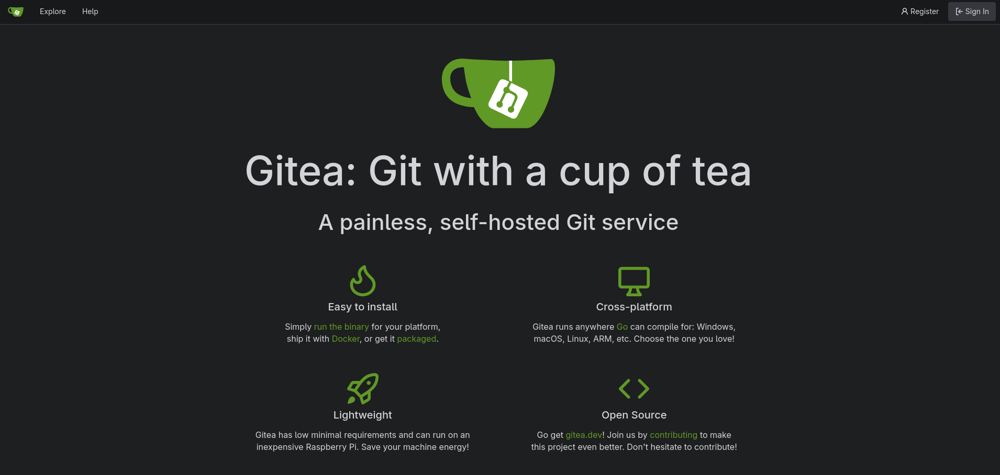
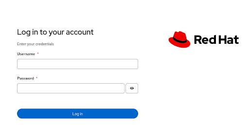

# Migration Toolkit for Applications Use-Cases

The [**Migration Toolkit for Applications**](https://developers.redhat.com/products/mta) (MTA) helps you to migrate your existing application. Its main use cases are:

1. **Legacy app assessment** — Static analysis of application source code and archives to inventory applications, identify technologies used, and estimate effort/cost of migration (sizing for modernization programs).
2. **Migration to newer platforms** — Moving Java applications from older application servers (WebLogic, WebSphere, JBoss EAP 4/5/6/7, Tomcat) to newer versions of JBoss EAP or other runtimes.
3. **Lift-and-shift to cloud / containers** — Migrating monoliths to OpenShift/Kubernetes, containerizing applications, and moving from on-premise to hybrid cloud.
4. **Java version upgrades** — Upgrading JDK versions and migrating from proprietary APIs to open standards (e.g., Java EE → Jakarta EE, Oracle JDK → OpenJDK).
5. **Monolith decomposition** — Identifying candidates for refactoring into microservices, highlighting hard-coded dependencies and configuration issues.
6. **Governance at scale** — Central reporting across a large application portfolio (wave planning), enabling organizations to plan, prioritize, and track modernization programs.

In practice MTA works in two modes: the **web console** (portfolio analysis, project/wave management) and the **CLI** (developer-driven, single-app analysis), producing detailed reports of issues, migration rules triggered, and suggested code changes. There's also IDE integration (VS Code) for inline remediation hints.

## Prerequisites

Below you can find the requirements for getting started with this PoC:

- **OpenShift CLI (oc)**: Ensure the `oc` command-line tool is installed and logged in to the target OpenShift cluster with `cluster-admin` privileges.
- **Helm CLI**: Ensure the `helm` CLI is installed (v3.x) for deploying the Gitea chart via Helm.
- **OpenShift Cluster Access**: An operational Red Hat OpenShift Container Platform cluster (v4.22 recommended) with sufficient resources for running OpenShift Dev Spaces and MTA workloads.
- **Subscription Requirements**: Ensure an active Red Hat Advanced Developer Suite (RHADS) subscription is available to access Developer Lightspeed services.
- **Storage & Registry Access**: A configured default StorageClass supporting dynamic persistent volume provisioning and access to the Red Hat Ecosystem Catalog/OperatorHub.
- **OpenAI-Compatible LLM Access**: Access to an OpenAI-compatible Large Language Model (LLM) endpoint and API key, required for Red Hat Developer Lightspeed and agentic migration features.
- **Define environment variables**: To ease the deployment of the Kubernetes resources later define these environment variables

```bash
export OPENAI_HOST=<Your LLM endpoint host>
export OPENAI_BASE_URL=https://${OPENAI_HOST}/v1
export OPENAI_API_KEY="<Your API Key>"
export OPENAI_MODEL_NAME="<Your Model name>"
export STORAGECLASS_RWX=ocs-external-storagecluster-cephfs
export OPENSHIFT_APPS_DOMAIN=$(oc get ingresses.config.openshift.io cluster -o jsonpath='{.spec.domain}')
```

## Gitea installation

To prevent unwanted changes and/or commits to existing source code, the original repos will be cloned into a Gitea instance that will be running on OpenShift.

- **Gitea Helmchart**: To install the Gitea Helmchart run
    ```bash
    oc apply -f gitea/gitea-namespace.yaml
    helm repo add gitea-charts https://dl.gitea.com/charts/
    helm repo update
    cat gitea/values.yaml | envsubst | helm install -n gitea -f - gitea gitea-charts/gitea
    oc wait --for=jsonpath='{.status.readyReplicas}'=1 statefulset gitea-valkey-primary -n gitea --timeout=600s
    oc wait --for=jsonpath='{.status.readyReplicas}'=1 statefulset gitea-postgresql -n gitea --timeout=600s
    cat gitea/create-db.sh | oc exec statefulset/gitea-postgresql -n gitea -i -t -- bash -il
    oc wait --for=jsonpath='{.status.readyReplicas}'=1 deployment gitea -n gitea --timeout=600s
    ```
    To verify that the deployment has been successful open the URL resulting from the following command:
    ```bash
    echo "Gitea URL: https://$(oc get route gitea -n gitea -o jsonpath='{.spec.host}')"
    ``` 
    You should see the following page:
    

    To login click on the `Sign in` button and use the credentials `gitea-admin/giteaftw!`.    
- **Verify Open API endpoint**: To verify if the Gitea Open API endpoint is working use
    ```bash
    curl -s -o /dev/null -w "%{http_code}\n" https://git.${OPENSHIFT_APPS_DOMAIN}/api/swagger
    ```
    The expected output should be `200`.
- **Access Token**:For any actions later we will need an access token

    ```bash
    export GITEA_ADMIN_TOKEN=$(curl -s -H "Content-Type: application/json" -d '{"name":"admin_token","scopes":["all"]}' -u 'gitea-admin:giteaftw!' "https://git.${OPENSHIFT_APPS_DOMAIN}/api/v1/users/gitea-admin/tokens" | jq -r '.sha1')
    ```
    To verify that the token works run
    ```bash
    curl -s -o /dev/null -w "%{http_code}\n" \
    "https://git.${OPENSHIFT_APPS_DOMAIN}/api/v1/user" \
    -H "Authorization: token ${GITEA_ADMIN_TOKEN}"
    ```
    This should return `200`.

    In case you need to delete this token use the following command
    ```bash
    curl --request DELETE https://git.${OPENSHIFT_APPS_DOMAIN}/api/v1/users/gitea-admin/tokens/admin_token   --header "Authorization: Basic $(echo -n 'gitea-admin:giteaftw!' | base64)"
    ```

- **Cloning Repositories**: Now we will clone the [JBoss EAP Quickstarts](https://github.com/jboss-developer/jboss-eap-quickstarts) repository into Gitea using the REST-API. This will also require to create an organization `jboss`

    ```bash
    curl -s -X POST "https://git.${OPENSHIFT_APPS_DOMAIN}/api/v1/orgs" \
    -H "Authorization: token ${GITEA_ADMIN_TOKEN}" \
    -H "Content-Type: application/json" \
    -d '{"username": "jboss", "visibility": "public"}'

    curl -X POST "https://git.${OPENSHIFT_APPS_DOMAIN}/api/v1/repos/migrate" \
    -H "Authorization: token ${GITEA_ADMIN_TOKEN}" \
    -H "Content-Type: application/json" \
    -d '{
        "clone_addr": "https://github.com/jboss-developer/jboss-eap-quickstarts",
        "repo_name": "jboss-quickstarts",
        "repo_owner": "jboss"
    }'

    curl -s -X POST "https://git.${OPENSHIFT_APPS_DOMAIN}/api/v1/admin/users" \
    -H "Authorization: token ${GITEA_ADMIN_TOKEN}" \
    -H "Content-Type: application/json" \
    -d '{
        "username": "jboss-dev",
        "email": "jboss-dev@example.com",
        "password": "jboss-dev",
        "must_change_password": false
    }'

    export GITEA_OWNERS_TEAM_ID=$(curl -s "https://git.${OPENSHIFT_APPS_DOMAIN}/api/v1/orgs/jboss/teams"   -H "Authorization: token ${GITEA_ADMIN_TOKEN}" | jq '.[].id')

    curl -s -X PUT "https://git.${OPENSHIFT_APPS_DOMAIN}/api/v1/teams/${GITEA_OWNERS_TEAM_ID}/members/jboss-dev"   -H "Authorization: token ${GITEA_ADMIN_TOKEN}"
    ```
    To verify if the cloning was successful run
    ```bash
    git clone https://git.${OPENSHIFT_APPS_DOMAIN}/jboss/jboss-quickstarts ~/jboss-quickstarts
    ```
## Agent Sandbox Installation
For Agentic Migrations via MTA we need to have the **Agent Sandbox Operator** installed as the agents will be running in sandboxes:

```bash
oc apply -f agent-sandbox/agent-sandbox-operator.yaml
```
The deployment of the Agent Sandbox operator can be verified like this:
    
```bash
oc wait --for=create deployment agent-sandbox-controller -n agent-sandbox-system --timeout=600s
oc wait --for=jsonpath='{.status.readyReplicas}'=1 deployment agent-sandbox-controller -n agent-sandbox-system --timeout=600s
```
The expected output for each command is **`condition met`**.

## Migration Toolkit for Applications (MTA) 8.3 

### Installation
MTA 8.3 provides automated analysis, assessment, and refactoring tooling for application modernization:
- **Prerequisites**: OpenShift Container Platform installed with cluster-admin privileges, along with persistent storage requirements including 1 RWO PV (10Gi) for the Hub database, 2 RWX PVs (100Gi each) for Maven cache and Hub bucket storage (if `rwx_supported` is enabled), and 1 RWO PV (5Gi) for the Developer Lightspeed database. You will also need access to a Large Language Model.
- **Deploy the Migration Toolkit for Applications Operator**:  Via the CLI by creating the target namespace, OperatorGroup, and Subscription resources:

    ```bash
    oc apply -f mta-ui/mta-operator.yaml
    ```
    The steps to verify if the deployment of the operator has finished successfully are as follows
    ```bash
    oc wait --for=jsonpath='{.status.phase}'=Succeeded csv mta-operator.v8.3.2 -n openshift-mta --timeout=600s
    oc wait --for=create deployment mta-operator -n openshift-mta --timeout=600s
    oc wait --for=jsonpath='{.status.readyReplicas}'=1 deployment mta-operator -n openshift-mta --timeout=600s
    ```
    Each command should return a **`condition met`**.
- **Create the Model Secret**: Create a Kubernetes Secret containing the API key and Base URL required for the self-hosted model LLM provider. This is needed for the Solution Server that is a core component deployed into the cluster that acts as an MCP server, maintaining persistent memory of refactoring resolutions and interfacing with Large Language Models (LLMs) via Retrieval-Augmented Generation (RAG):
    ```bash
    cat mta-ui/mta-ls-llm-provider-secret.yaml | envsubst | oc apply -f -
    ```
- **Create a Konveyor Gateway**: The `Konveyor Gateway` abstracts the access to the LLM.
    ```bash
    cat mta-ui/llm-gateway.yaml | envsubst | oc apply -f -
    ```
    To verify the gateway instantiation execute
    ```bash
    oc wait --for create gateways.konveyor.io openai -n openshift-mta --timeout=600s
    oc wait --for=jsonpath='{.status.connectionVerified}'="true" gateways.konveyor.io openai -n openshift-mta --timeout=600s
    ```
    All these commands should return `condition met`.


    If you want to change the model you have two options:
    - Change the current `Konveyor Gateway` resource
    - Create another `Konveyor Gateway` resource in addition

    If you later you want to run an `Agentic Migration` you will be prompted which Konveyor Gateway to use.
- **Configure the Tackle Instance**: Create a Tackle instance specifying the amount of storage needed, enabling Developer Lightspeed and configuring the Large Language Model (LLM):

    ```bash
    cat mta-ui/tackle.yaml | envsubst | oc apply -f -
    ```
    Wait until the installation has finished successfully:
    ```bash
    oc wait --for=create deployment mta-ui -n openshift-mta --timeout=600s
    oc wait --for=create deployment mta-hub -n openshift-mta --timeout=600s
    oc wait --for=create deployment kai-db -n openshift-mta --timeout=600s
    oc wait --for=create deployment kai-api -n openshift-mta --timeout=600s
    oc wait --for=create deployment agentic-controller -n openshift-mta --timeout=600s
    oc wait --for=jsonpath='{.status.readyReplicas}'=1 deployment mta-ui -n openshift-mta --timeout=600s
    oc wait --for=create deployment mta-hub -n openshift-mta --timeout=600s
    oc wait --for=jsonpath='{.status.readyReplicas}'=1 deployment mta-hub -n openshift-mta --timeout=600s
    oc wait --for=jsonpath='{.status.readyReplicas}'=1 deployment kai-db -n openshift-mta --timeout=600s
    oc wait --for=jsonpath='{.status.readyReplicas}'=1 deployment kai-api -n openshift-mta --timeout=600s
    oc wait --for=jsonpath='{.status.readyReplicas}'=1 deployment agentic-controller -n openshift-mta --timeout=600s
    ```
    All these commands should return `condition met`.
- **Workaround for Storage issue**: In some cases there may be an issue with the cache PVC (`/cache/m2 can't be created`), this is how to fix it:

    ```bash
    oc apply -f mta-ui/cache-pvc-inspector.yaml
    oc wait --for=create deployment cache-pvc-inspector -n openshift-mta --timeout=600s
    oc wait --for=jsonpath='{.status.readyReplicas}'=1 deployment cache-pvc-inspector -n openshift-mta --timeout=600s
    echo "mkdir /cache/m2" | oc exec deployment/cache-pvc-inspector -n openshift-mta -i -t -- bash -il
    ```
    To verify that the directory has been created run
    ```
    oc exec deployment/cache-pvc-inspector -n openshift-mta -- \
  bash -c "if [ -d /cache/m2 ]; then echo '/cache/m2 exists'; else echo '/cache/m2 does not exist'; fi"
    ```
    The expected output should be `/cache/m2 exists`.

    We can now delete the PVC inspector deployment
    ```bash
    oc delete -f mta-ui/cache-pvc-inspector.yaml
    ```

- **Accessing the MTA UI**: The MTA UI can be accessed like this:

    ```bash
    echo "MTA UI: https://$(oc get route mta -n openshift-mta -o jsonpath='{.spec.host}')"
    ``` 
    You should be presented with a screen like this:

        

    Login with `admin/admin`.

### Automation via REST API

Using the Konveyor [Tackle2-Hub API](https://github.com/konveyor/tackle2-hub/blob/main/docs/swagger.yaml) you can automate the configuration of the MTA.

> ⚠️ WARNING
>
> The Tackle2-Hub API is an internal implementation detail that is not a supported product feature.

For this we first need to get the endpoint:
```bash
export MTA_URL="https://$(oc get route mta -n openshift-mta -o jsonpath='{.spec.host}')"
```

#### Creating Stakeholders, Stakeholder Groups and Business Service
Create a stakeholder and assign him to the stakeholder group named **JBoss Quickstarts** and a business service named **JBoss Onboarding**.
```bash
MTA_USER_ID=$(curl -s -X POST "${MTA_URL}/hub/stakeholders"   -u admin:admin   -H "Content-Type: application/json"   -d '{
"name": "John Doe",
"email": "john@example.com",
"jobFunction": {"id": 1, "name": "IT"}
}' | jq '.id')

curl -s -X POST "${MTA_URL}/hub/stakeholdergroups" \
-u admin:admin \
-H "Content-Type: application/json" \
-d "{
    \"name\": \"JBoss EAP Quickstarts\",
    \"description\": \"Stakeholders owning migrated JBoss EAP Quickstarts applications\",
    \"stakeholders\": [
    {\"id\": ${MTA_USER_ID}, \"name\": \"John Doe\"}
    ]
}"

curl -s -X POST "${MTA_URL}/hub/businessservices" \
-u admin:admin \
-H "Content-Type: application/json" \
-d "{
    \"name\": \"JBoss Onboarding\",
    \"description\": \"Onboarding Developers onto JBoss\",
    \"owner\": {\"id\": ${MTA_USER_ID}, \"name\": \"John Doe\"}
}"
```

#### Configure Maven settings

if you need a custom Maven `settings.xml`, f.e. for connecting to [JFrog Artifactory](https://jfrog.com/artifactory/) or [Sonatype Nexus](https://www.sonatype.com/products/sonatype-nexus-repository) you can use the following command as an example, which configures the `Red Hat GA` repository for dependencies and plugins:

```bash
export MAVEN_SETTINGS=$(cat mta-ui/maven-settings.xml | sed 's/\"/\\\"/g' | tr '\n' ' ')
curl -s -X POST "${MTA_URL}/hub/identities" \
  -u admin:admin \
  -H "Content-Type: application/json" \
  -d '{
    "name": "maven-redhat-ga-settings",
    "kind": "maven",
    "description": "Maven settings for Red Hat GA repository",
    "default": false,
    "settings": "${MAVEN_SETTINGS}"
  }'
```

#### Bulk Uploading Applications

```bash
cat mta-ui/template_application_import.csv | envsubst > mta-ui/application_import.csv
curl -s -X POST "${MTA_URL}/hub/importsummaries/upload" \
  -u admin:admin \
  -F "file=@mta-ui/application_import.csv"
```

On success it returns `201 Created` with an `ImportSummary` JSON object.

#### Create default Git credentials

During the execution of **Agentic Workflows** information will be stored in Gitea. As the repository is protected by basic auth credentials we need to setup a default credential like this:

```bash
curl -s -X POST "${MTA_URL}/hub/identities" \
  -u admin:admin \
  -H "Content-Type: application/json" \
  -d '{
    "name": "git-credentials",
    "description": "Default Git credentials for cloning quickstarts",
    "kind": "source",
    "user": "jboss-dev@example.com",
    "password": "jboss-dev",
    "default": true
  }'
```

#### Define an Analysis Profile

```bash
curl -s -X POST "${MTA_URL}/hub/analysis/profiles" \
  -u admin:admin \
  -H "Content-Type: application/json" \
  -d '{
    "name": "JBoss EAP 7.4 to JBoss EAP 8",
    "description": "Analysis profile for migrating JBoss EAP 7.4 to JBoss EAP 8",
    "mode": { "withDeps": true },
    "scope": {
      "packages": {
        "included": ["org.jboss.eap.quickstarts.*"]
      },
      "withKnownLibs": false
    },
    "rules": {
      "labels": {
        "included": ["konveyor.io/target=jakarta-ee+", "konveyor.io/source=java-ee+"]
      }
    }
  }'
```

No fields are strictly required (an empty profile is valid), but a useful one sets mode, scope, and rules.

#### Create custom Skills and Rules

For Agentic Migrations, MTA composes agent workloads from **Skills** (SKILL.md files following the [Agent Skills](https://agentskills.io) format), packaged as OCI images or defined inline, and referenced via `SkillCard`, `Agent`, and `AgentWorkflow` custom resources. A workflow runs stages sequentially — typically `plan` → `execute` → `verify` — each in a fresh Agent Sandbox, with continuity provided by committed handoff files (`docs/plan.md`, `.konveyor/handoff.md`) on the shared target branch. The [Konveyor agentic-controller](https://github.com/konveyor/agentic-controller) documentation covers the full details.

> ⚠️ NOTE
>
> The agentic-controller operator already installs working examples (SkillCards `plan`/`execute`/`verify`, Agents `migration-plan/execute/verify-agent`, and the `java-ee-to-quarkus` AgentWorkflow), so copy those as a starting point rather than authoring from scratch.

- **Author the skill**: Create a directory with a `SKILL.md` file containing YAML frontmatter `name` and `description`:

    ```
    my-skill/
    ├── SKILL.md
    ├── references/       optional supporting material
    ├── scripts/          optional executable helpers
    └── assets/           optional templates or assets
    ```

    ```markdown
    ---
    name: maven-migration
    description: Migrates Maven POM files from Java EE to Jakarta EE.
    ---

    # Maven Migration

    Inspect every POM, replace `javax.*` dependencies with Jakarta equivalents,
    and run the project's build to verify the result.
    ```

    The frontmatter field set is closed — do not add `type` to `SKILL.md`. The load policy (`skill` = on-demand vs. `rule` = always-loaded in every prompt) lives on the `SkillCard` CR, not the content.


- **Login into registry.redhat.io**: To build the 'SkillCard` we need to login into registry.redhat.io with a ```Service Account```. See  [Red Hat Container Registry Authentication](https://access.redhat.com/RegistryAuthentication) on how to create it.
    ```bash
    podman login -u <service-account-username> registry.redhat.io
    ```
- **Package as an OCI image**: For a single skill, put `SKILL.md` at the image root; for several skills, use one directory per skill. Discovery is filesystem-based: `SKILL.md` at the image root means one skill, otherwise each immediate subdirectory containing a `SKILL.md` is discovered as an individual skill.

    ```bash
    podman build -t quay.io/telco-coe-emea/mta-jboss-eap-7-to-8-skills:8.3.1 -f mta-ui/agentic-workflow/jboss-eap-7-to-8/agents/skills/jboss-eap-7-to-8/Containerfile mta-ui/agentic-workflow/jboss-eap-7-to-8/agents/skills/jboss-eap-7-to-8
    podman tag quay.io/telco-coe-emea/mta-jboss-eap-7-to-8-skills:8.3.1 quay.io/telco-coe-emea/mta-jboss-eap-7-to-8-skills:latest
    podman push quay.io/telco-coe-emea/mta-jboss-eap-7-to-8-skills:8.3.1 quay.io/telco-coe-emea/mta-jboss-eap-7-to-8-skills:8.3.1    
    ```

- **Create a SkillCard**: A `SkillCard` represents exactly one skill and can point at an OCI image, a git repository, or inline content. The loader validates the image at pod initialization and assembles the selected skill at `/opt/skills/<frontmatter-name>/SKILL.md`. For an image holding several skills, select one immediate directory with `subPath` (a bundle without `subPath` is ambiguous and is rejected rather than silently becoming several skills). The `type` field is the load policy and lives on the CR, not in `SKILL.md`:
    - `type: skill` — on-demand: the runtime starts with only the name and description and reads the full content when it invokes the skill.
    - `type: rule` — always-loaded: the harness includes the full content in every agent prompt (e.g. a stage's driving skill should be a rule).

    An inline skill (no registry involved) uses `inline:` instead of `image:` and is materialized as a ConfigMap. Note inline skills are a single `SKILL.md` (a ConfigMap key cannot contain a path separator), so anything needing `references/` has to be an image or git source.

    ```yaml
    apiVersion: konveyor.io/v1alpha1
    kind: SkillCard
    metadata:
      name: jboss-eap-7-to-8
      namespace: openshift-mta
    spec:
      image: quay.io/telco-coe-emea/mta-jboss-eap-7-to-8-skills:8.3.1
      displayName: JBoss EAP 7 to 8 Migration Skill
      version: "0.0.1"
      description: Migrates from JBoss EAP 7 to JBoss EAP 8.
      type: skill
      subPath: skill 
      tags:
        - java
        - javaee
        - eap
        - migration
    ```

    ```bash
    oc apply -f mta-ui/agentic-workflow/jboss-eap-7-to-8/agents/skills/jboss-eap-7-to-8/jboss-eap-7-to-8-skillcard.yaml
    ``` 
    The `SkillCard` can be verified like this

    ```bash
    oc wait --for create skillcard jboss-eap-7-8 -n openshift-mta --timeout=600s
    oc wait --for jsonpath='{.status.conditions[0].status}'="True" skillcard jboss-eap-7-8 -n openshift-mta --timeout=600s
    ```

- **Create the Agent**: An Agent is a template — it declares the container image, skills, and turn limits but executes nothing. Omitting `spec.gateways` is intentional: the Gateway is then named at run time on the `AgentRun`/`AgentWorkflowRun` (this is what the [Konveyor Gateway](#create-a-konveyor-gateway) set up earlier is used for).

    ```bash
    oc apply -f mta-ui/agentic-workflow/jboss-eap-7-to-8/agents/jboss-eap-7-to-8-plan-agent.yaml
    oc apply -f mta-ui/agentic-workflow/jboss-eap-7-to-8/agents/jboss-eap-7-to-8-execute-agent.yaml
    oc apply -f mta-ui/agentic-workflow/jboss-eap-7-to-8/agents/jboss-eap-7-to-8-verify-agent.yaml
    ```
    Several Agents sharing skills can reference a `SkillCollection` grouping multiple `SkillCard`s instead.
    
    To check if defining the agents have been successful run
    ```bash
    oc wait --for create agent jboss-eap-7-to-8-plan-agent -n openshift-mta --timeout=600s
    oc wait --for create agent jboss-eap-7-to-8-execute-agent -n openshift-mta --timeout=600s
    oc wait --for create agent jboss-eap-7-to-8-verify-agent -n openshift-mta --timeout=600s
    oc wait --for jsonpath='{.status.conditions[0].status}'="True" agent jboss-eap-7-to-8-plan-agent -n openshift-mta --timeout=600s
    oc wait --for jsonpath='{.status.conditions[0].status}'="True" agent jboss-eap-7-to-8-execute-agent -n openshift-mta --timeout=600s
    oc wait --for jsonpath='{.status.conditions[0].status}'="True" agent jboss-eap-7-to-8-verify-agent -n openshift-mta --timeout=600s
    ```
- **Create the AgentWorkflow**: Combines an ordered sequence of stages, each referencing an Agent. Stages run sequentially, each in a fresh Sandbox. `plan.md` is not something you author — it is the output contract of the plan stage: the plan skill defines the exact `docs/plan.md` structure (Goal, Source → Target, Scope, Steps with Phase/File/Action/Depends-on/Verify, Verification, Notes) and the execute and verify stages parse it, so a custom plan skill must reproduce this output structure exactly.

    ```bash
    oc apply -f mta-ui/agentic-workflow/jboss-eap-7-to-8/jboss-eap-7-to-8-agent-workflow.yaml
    ```

    Verify the existence of the `AgentWorkflow` as follows:
    ```bash
    oc wait --for create agentworkflow jboss-eap-7-to-8 -n openshift-mta --timeout=600s
    oc wait --for jsonpath='{.status.conditions[0].status}'="True" agentworkflow jboss-eap-7-to-8 -n openshift-mta --timeout=600s
    ```

## OpenShift Dev Spaces Installation

**OpenShift Dev Spaces** provides Kubernetes-based cloud development environments and is installed on the OpenShift Container Platform using the OpenShift Dev Spaces Operator via OperatorHub:

- **Prerequisites**: Ensure OpenShift Container Platform v4.22 is running, log in as a user with cluster-admin privileges, ensure a default StorageClass is configured, and verify adequate cluster CPU and memory resources.
- **Dev Spaces Operator Installation**: Deploy the OpenShift Dev Spaces Operator via the CLI by creating the target namespace, OperatorGroup, and Subscription resources:

```bash
oc apply -f devspaces/openshift-devspaces-operator.yaml
```